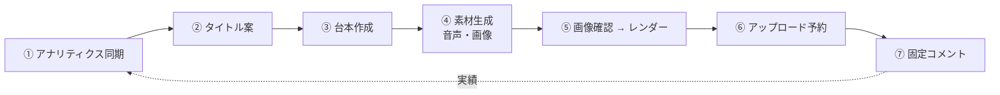

# Native Video Factory 操作マニュアル

このドキュメントでは、本システムを使って日々の動画を生成・アップロードするための具体的な操作手順を解説します。

> [!NOTE]
> セットアップ・起動は **[README.md](README.md)**、設定値や仕様の詳細は **[SPEC.md](SPEC.md)** を参照してください。

---

## 📑 目次

- [🔄 全体の流れ](#-全体の流れ)
- [0. 作業前の準備](#0-作業前の準備)
- [基本ワークフロー（7ステップ）](#基本ワークフロー7ステップ)
- [⚙️ チャンネル・テンプレートの管理](#️-チャンネルテンプレートの管理)
- [💡 応用的な使い方](#-応用的な使い方)
- [🎚 生成オプション早見表](#-生成オプション早見表)
- [🆘 困ったときは（FAQ）](#-困ったときはfaq)

---

## 🔄 全体の流れ

| ステップ | 画面 | やること |
|:--|:--|:--|
| ① 同期 | アナリティクス | 既存チャンネルの実績取得（新規はスキップ可） |
| ② タイトル | 動画生成 | プロンプトをコピー→AIでタイトル案 |
| ③ 台本 | 動画生成 | プロンプトをコピー→AIで台本 |
| ④ 素材生成 | 動画生成 | 台本を貼って「生成開始」（音声・背景・サムネ） |
| ⑤ レンダー | 履歴詳細 | 画像確認→「動画再作成（レンダーのみ）」でMP4化 |
| ⑥ アップロード | アップロード | チェック→予約投稿（再生リストも自動振り分け） |
| ⑦ コメント | 固定コメント | 公開後に固定コメント投稿 |

---

## 0. 作業前の準備

動画生成を始める前に、以下の準備が整っているか確認してください。

1. **VOICEVOXの起動**
   ローカルで VOICEVOX を立ち上げておきます。
2. **Web UIの起動**
   `start.ps1`（Windows）または `start.command`（macOS）を実行し、ブラウザで Web UI を開きます。
3. **外部サービスの確認**
   ホーム画面で、VOICEVOX や ffmpeg が「利用可能」になっているか確認します。

---

## 基本ワークフロー（7ステップ）

動画投稿までの最短ルートは以下の通りです。

### Step 1: アナリティクス同期（既存チャンネルの場合のみ）
> [!NOTE]
> 新規チャンネルで過去の動画がまだない場合は、このステップをスキップして **Step 2** へ進んでください。

1. 左メニューから **📊 アナリティクス** 画面を開きます。
2. **「🔄 実績データを同期」** ボタンを押し、YouTube から最新の視聴データ（再生数、平均視聴率、高評価率など）を取得します。
3. 同期が完了すると、過去動画がスコア（A〜E）と共に一覧表示されます。このデータは次の「タイトル案作成」でプロンプトに組み込まれ、実績に基づいたより良いタイトル生成に役立ちます。

### Step 2: タイトル案の作成

1. 左メニューから **✨ 動画生成** 画面を開きます。
2. 画面上部にある **「📝 Shortsタイトル案」** または **「📝 Longタイトル案」** ボタンをクリックします。
   （※アナリティクス実績を組み込んだ ChatGPT / Gemini 用の「タイトル案生成プロンプト」が自動でクリップボードにコピーされます）
3. ブラウザで ChatGPT または Gemini を開き、コピーしたプロンプトを貼り付けて実行します。
4. AI が出力したタイトル案の中から、今回作成するテーマを1つ選びます。

### Step 3: 台本の作成

1. 再び **✨ 動画生成** 画面に戻り、**「🤖 AI台本作成」** ボタンをクリックします。
   （※台本生成用のプロンプトがクリップボードにコピーされます）
2. ChatGPT または Gemini で、先ほど選んだタイトル案に対する指示として、コピーしたプロンプトを貼り付けます。
   > **入力例:**
   > 「案3の『〇〇の歴史』で台本を作ってください。 [ここにコピーしたプロンプトを貼り付け]」
3. AI が出力した台本テキスト全体（`動画形式: Shorts` などのメタ情報から最後まで）をコピーします。

### Step 4: 動画素材の生成（音声・画像）

1. **✨ 動画生成** 画面にあるテキストエリアに、コピーした台本を貼り付けます。
2. 必要に応じて生成オプション（画像スタイル / 背景を再利用する など）を設定します。各オプションの効果は [🎚 生成オプション早見表](#-生成オプション早見表) を参照してください。
3. **「🚀 生成開始」** ボタンをクリックします。
4. バックグラウンドで**品質チェック → よみがな正規化 → 音声合成 → 背景・サムネイル生成** が全自動で走ります。
   進捗は画面右下のトースト通知や、ログ画面で確認できます。

### Step 5: 画像の確認とネイティブレンダリング

素材が完成したら、最後に動画ファイル（MP4）として書き出します。

1. 左メニューの **📚 履歴一覧** から、いま生成したテーマの「詳細」を開きます。
2. （任意）詳細画面の **「🖼 画像確認・再生成」** から、AIが生成した背景画像やサムネイルを確認します。
   - もし気に入らない画像があれば、プロンプトを少し書き換えて「この画像を再生成」ボタンで個別に作り直すことができます。
3. 準備ができたら、履歴詳細画面の **「🎬 動画再作成（レンダーのみ）」** をクリックします。
4. レンダリングが完了すると、MP4動画が出力され、画面上で「生成済みの MP4 動画」として再生確認ができるようになります。

### Step 6: YouTubeへのアップロード

1. 左メニューの **☁️ アップロード** 画面を開きます。
2. 投稿待ちの動画一覧が表示されるので、投稿したい動画にチェックを入れます。
3. （任意）左メニューの **📅 スケジュール** 画面を開くと、YouTube上の現在の予約カレンダーを確認できます。
4. アップロード画面で **「📤 チェックした動画をアップロード」** を押すと、システムのスケジュールロジックに従い、自動的に最適な日時に予約投稿が行われます。
   - 台本に `再生リスト:` が指定されていた場合、YouTube上の再生リストへも自動で振り分けられます。

### Step 7: 固定コメントの投稿

> [!WARNING]
> 動画が「公開済み」になった後に行う作業です。（予約期間中は行えません）

1. 左メニューの **💬 固定コメント** 画面を開きます。
2. 未投稿の公開済み動画一覧が表示されるので、投稿したい動画を選んで **「投稿する」** を押します。
3. 台本生成時にあらかじめ作られていた「固定コメント（動画の要約＋視聴者への質問）」がYouTubeに投稿されます。
   ※ ピン留め機能はAPIの制限上自動化できないため、YouTube Studioから手動で「ピン留め」を行ってください。

---

## ⚙️ チャンネル・テンプレートの管理

### チャンネルの切り替え

複数のYouTubeチャンネルを運用している場合、画面右上のチャンネル名をクリックするとドロップダウンが表示されます。切り替えたいチャンネルを選ぶと、以降の操作（履歴・生成・アップロード・Analytics・固定コメント・スケジュール）がすべてそのチャンネルを対象に切り替わります。

新しいチャンネルを追加するには、**⚙️ 設定** → 「チャンネル」タブ → 「＋ チャンネルを追加」から登録してください。

### プロンプトテンプレートの管理

台本生成・タイトル案・ネタ会議の各プロンプトは、チャンネルごとにDB上のテンプレートとして管理されています。

確認・編集手順:
1. **⚙️ 設定** → 「テンプレート」タブを開きます。
2. 現在のチャンネルのテンプレートが「台本生成」「タイトル案」「ネタ会議」の3種類で表示されます。
3. 「編集」ボタンで内容を変更できます。「★デフォルト」が付いているテンプレートが生成ボタン押下時に使用されます。

チャンネルを新しく追加したとき、テンプレートが自動作成されない場合は **「テンプレート」タブ** 右上の「再読込」を試すか、設定ページで `POST /api/prompt-templates/seed` を実行してください。

---

## 💡 応用的な使い方

### Long サムネイルの A/B テスト
Long動画を生成する際、動画生成画面で **「LongサムネAB」** にチェックを入れて生成すると、3パターンの異なるサムネイル（クローズアップ・歴史・比較ギャップ）が同時に生成されます。
YouTube Studioの「サムネイルのテストと検証」機能でこれらの画像をアップロードし、どれがクリックされやすいかを検証できます。

### Long 画像節約モード
Long動画で背景画像が数十枚になる場合、APIコストと生成時間を節約したい時は **「Long節約」** にチェックを入れてください。
新規の画像生成枚数を上限（例: 16枚）に抑えつつ、レンダラーの「ゆっくりズーム（Ken Burns効果）」を活かして、画面が退屈にならないよう自動で前の画像を賢く再利用します。

### 台本の一括生成・レンダリング
台本をテキストエリアに貼り付ける際、`━━ タイトル ━━` という区切り線を使うか、`動画形式:` のブロックを複数並べることで、2本以上の動画を一度にキューに入れることができます。
夜間などに複数の台本をまとめて処理させたい場合に便利です。

> [!NOTE]
> 複数本を入れても**ジョブは既定で1本ずつ順番に実行**されます（同時実行はWebが重くなるため）。キュー状況はログ画面で確認できます。

### ネタ会議（次回ネタの企画コント）
`動画形式: ネタ会議`（または `ネタ会議Long` / `ネタ会議Shorts`）の台本を使うと、次回制作に向けた**候補ネタ（4〜5個）をずんだもんと四国めたんが査定する2〜4分のミニ番組**として生成されます。

- 四国めたんが辛口の編集者役で企画・タイトルを査定します。
- `ネタ会議Long` は横画面（1920×1080）、`ネタ会議` / `ネタ会議Shorts` は縦画面（1080×1920）。`画面形式: 横` でも横になります。
- プレミア公開や視聴者アンケート/コメント投票での「次回ネタ決め」を想定した形式です。候補データは `metadata.db` に保存されます。
- 第1部（候補一覧）には実績の具体数値を保存しますが、第2部（本編）では数値を読み上げず「反応がよかった」等の自然な表現に変換されます。

### よみがな（読み）の修正
VOICEVOX が固有名詞・専門用語を誤読する場合は、辞書に登録すると次回以降の生成で自動補正されます。

1. **⚙️ 設定** → 「よみがな辞書」で、誤読する語と正しい読み（ひらがな/カタカナ）を登録します。
2. 辞書は **全チャンネル共通**です（チャンネルを切り替えても同じ辞書が使われます）。
3. 登録後に生成・レンダーした動画から読みが反映されます（既存の音声には自動では反映されません。必要なら音声を再生成してください）。

---

## 🎚 生成オプション早見表

動画生成画面のチェックボックス・選択肢の早見表です。

| オプション | 既定 | ONにすると | 使いどころ |
|:--|:--|:--|:--|
| 画像スタイル | アニメ | 通常 / アニメ / 水彩 で絵柄が変わる | チャンネルの世界観に合わせる |
| 背景を再利用する | ON | 既存の同テーマ背景を使い回し未生成分だけ生成 | 失敗分の作り直し・コスト節約 |
| LongサムネAB | OFF | サムネを3案同時生成（A/B/C） | Long のサムネ比較検証 |
| Long節約 | OFF | 背景枚数を上限に抑え賢く再利用 | Long のコスト・時間節約 |
| BGM | チャンネル既定 | 個別指定 / BGMなし を選べる | 動画ごとに BGM を変えたいとき |

---

## 🆘 困ったときは（FAQ）

| 症状 | 対処 |
|:--|:--|
| 音声が生成されない | VOICEVOX が起動しているか（`http://localhost:50021`）確認。 |
| 画像が生成されない | 設定→APIキーで Google API Key が「登録済み」か確認。 |
| **背景生成で「API混雑(503 / `E-IMG-BUSY`)」** | Gemini/Nano Banana 側の一時的な混雑で、**台本・プロンプトの問題ではありません**。生成済み背景は残るので、時間を置いて履歴から **背景再利用**で再生成すれば未生成分だけ作り直せます。 |
| 認証エラー（`E-IMG-AUTH` / 401・403） | APIキーの値・権限を確認。 |
| クォータ超過（`E-IMG-QUOTA` / 429） | 時間を置いて再実行。 |
| 生成した画像が気に入らない | 履歴詳細→画像確認から、プロンプトを直して**個別に再生成**。 |
| 複数同時生成でUIが重い・固まる | 生成・レンダーは別プロセスの job-runner で実行します。`JOB_MAX_CONCURRENT_WORKERS` を上げると並列実行できます。 |
| ログ画面が更新で見づらい・コピペできない | ログ更新間隔は `WEB_LOG_POLL_INTERVAL_MS`（既定8秒）で調整可。テキスト選択中は自動更新が止まります。 |
| もっと詳しいログを見たい | Web側は `output/000_data/debug_logs/app_debug_web.log`、生成・レンダーrunner側は `app_debug_runner.log` に残ります。 |
| GPUエンコードが使われない | `h264_nvenc` 不可時は自動で `libx264`（CPU）へ切替（ログに警告）。 |
| アプリが終了しない | 生成中に終了ボタンを押すと確認ダイアログ→「停止して終了」。 |
