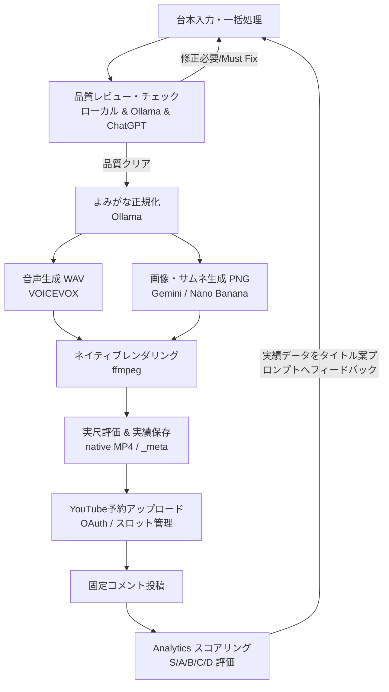

# Native Video Factory 🎥

「ずんだもんとめたんの食べ物雑学堂」向けに、食べ物雑学の解説動画を台本から自動生成するローカルWebツールです。  
台本を入力するだけで、**VOICEVOXによる音声合成**、**Gemini (Nano Banana Suite) による背景画像生成**、**ffmpegによる高品質なネイティブMP4動画のレンダリング**、そして**YouTubeへの予約投稿・アナリティクス分析**までをシームレスに行うことができます。

---

## 🔄 システム処理フロー

本システムは、以下のパイプラインに沿って動画を完全自動で生成・投稿します。



---

## 🚀 クイックスタート

通常運用では、リポジトリ直下の `start.bat` から起動する方法を推奨します。仮想環境の Python を直接指定して Web UI を起動し、ブラウザも自動で開きます。

1. **VOICEVOX を起動**しておきます（デフォルトポート: `50021`）。
2. リポジトリ直下の `start.bat` をダブルクリック、またはターミナルから起動します。
   ```powershell
   .\start.bat
   ```
3. 自動的にブラウザが立ち上がり、`http://127.0.0.1:58080` にアクセスできます。

`start.bat` は内部で次を実行します。

```cmd
.venv\Scripts\python.exe -m web_app.app --open-browser --reload
```

普段の操作入口はローカル Web UI だけです。旧Tkinter GUIや直接CLI生成は廃止済みです。

---

## 🛠 前提条件 (Prerequisites)

本ツールを使用するには、以下の外部ソフトウェアがローカル環境に導入されている必要があります。

1. **Python 3.10 以上** (本プロジェクトでは `.venv` 仮想環境を使用します)
2. **VOICEVOX** ([公式ホームページ](https://voicevox.nero.ne.jp/)からダウンロード)
3. **ffmpeg** (パスを通しておくか、環境変数 `FFMPEG_BIN` にバイナリパスを指定してください)
4. **Ollama** (よみがな正規化および冒頭品質レビューに利用。デフォルトモデル: `qwen2.5:7b` / `qwen3:8b`)

---

## 📦 セットアップ手順

### Step 1. 仮想環境と依存パッケージの準備
Windowsでは、システムの Python ではなく、プロジェクト専用の `.venv` を使います。既に `.venv` が用意済みなら作成手順は不要です。

`.venv` がない場合:

```powershell
py -3 -m venv .venv
```

*   **PowerShell の場合:**
    ```powershell
    # 仮想環境のアクティベート
    .venv\Scripts\Activate.ps1
    # 依存関係のインストール・更新
    pip install --upgrade requests google-genai python-dotenv Pillow google-api-python-client google-auth-oauthlib openai fastapi "uvicorn[standard]" jinja2 python-multipart
    ```
*   **コマンドプロンプト (cmd) の場合:**
    ```cmd
    :: 仮想環境のアクティベート
    .venv\Scripts\activate.bat
    :: 依存関係のインストール・更新
    pip install --upgrade requests google-genai python-dotenv Pillow google-api-python-client google-auth-oauthlib openai fastapi "uvicorn[standard]" jinja2 python-multipart
    ```

### Step 2. APIキーとOAuth設定ファイルの配置
リポジトリ直下に環境設定ファイル `.env` を作成し、各種APIキーを設定します。Web UI の `設定` 画面からもAPIキーを保存できますが、初回は `.env` を直接作成しておくと確実です。

```env
GOOGLE_API_KEY=your_gemini_api_key
OPENAI_API_KEY=your_openai_api_key
```

*   **`GOOGLE_API_KEY`:** Google AI Studio (Gemini API) から取得します。台本や背景画像の生成に使われます。
*   **`OPENAI_API_KEY`:** OpenAI Platform から取得します。ChatGPT による台本の生成前最終レビュー（`gpt-5.2`）で使われます。
*   **`client_secrets.json`:** YouTube API を利用するための OAuth 2.0 クライアント認証情報（デスクトップアプリ用）です。Google Cloud Console からダウンロードし、**リポジトリ直下**に配置してください。

> [!IMPORTANT]
> - `client_secrets.json`, `.env`, `token.json`, `token_analytics.json` は個人情報やAPIキーを含むため、**絶対に Git にコミットしないでください**（`.gitignore` で除外されています）。
> - YouTubeアップロード、アナリティクス、スケジュール同期などを初めて利用する際、ブラウザが開いて Google 認証を求められます。認証に成功すると、プロジェクトルートに `token.json` と `token_analytics.json` が自動生成されます。

### Step 3. プロンプト設定の確認
初期状態では、本プロジェクトの「食べ物雑学」用の設定が適用されます。  
もし別のジャンルで運用する場合は、`core/prompt_parts/local/` ディレクトリを作成し、そこに個人用プロンプト部品を配置してください（このディレクトリ内のファイルが最優先で読み込まれます）。

*   **食べ物用のデフォルト設定を復元・初期化したい場合 (PowerShell):**
    ```powershell
    New-Item -ItemType Directory -Force -Path core\prompt_parts\local
    Copy-Item -Path samples\prompt_parts\food\* -Destination core\prompt_parts\local\ -Force
    ```

---

## 💻 起動方法と起動オプション

### 推奨: start.bat で起動

通常は `start.bat` を使います。仮想環境の有効化操作は不要です。

```powershell
.\start.bat
```

VOICEVOXを起動してから実行してください。起動後は `http://127.0.0.1:58080` を開きます。

### 手動起動（トラブル対応・開発用）

ポート変更やリロード設定を自分で指定したい場合だけ、仮想環境の Python を直接実行します。

*   **通常起動 (PowerShell):**
    ```powershell
    .\.venv\Scripts\python.exe -m web_app.app
    ```
*   **自動でブラウザを開く場合:**
    ```powershell
    .\.venv\Scripts\python.exe -m web_app.app --open-browser
    ```
*   **開発用（ファイル変更時の自動リロードを有効にする）:**
    ```powershell
    .\.venv\Scripts\python.exe -m web_app.app --reload --open-browser
    ```

> [!TIP]
> **Windowsで「Python was not found...」というエラーが出る場合:**
> システム環境変数 (PATH) に Python が通っていない可能性があります。まず `start.bat` を使ってください。手動起動する場合は、上記の通り `.\.venv\Scripts\python.exe` のように**仮想環境のパスを明示的に指定して実行**します。

### 主要な起動引数

| オプション | 説明 |
| :--- | :--- |
| `--port N` | ポートを指定して起動（デフォルト: `58080`） |
| `--auto-port` | 指定ポートが競合している場合、自動的に次の空きポートを探して起動 |
| `--open-browser` | サーバー起動後、自動的に既定のウェブブラウザを開く |
| `--reload` | 関連ソースコードの変更を検知した際に、自動でUvicornサーバーを再起動する（`start.bat` では既定で有効） |

---

## 📝 基本のワークフロー

1.  **起動:** VOICEVOXを起動し、`start.bat` でWeb UIを開きます。
2.  **実績の同期:** `Analytics` 画面で YouTube Analytics の最新実績データを取得します。
3.  **タイトル案プロンプト作成:** `生成` 画面の `Shortsタイトル案プロンプト` / `Longタイトル案プロンプト` をコピーし、実績データを組み込んだプロンプトで AI にタイトル案を出させます。
4.  **台本作成:** 採用したタイトルから、`AI台本作成プロンプト` をコピーして AI に台本を作成させます。
5.  **台本のチェック・生成:** Web UI の台本欄に貼り付け、必要に応じて `チェック` 画面または生成前レビューで確認し、`生成開始` を押します。
6.  **画像・動画の確認:** `履歴` または `画像確認・再生成` 画面でサムネイルと背景画像を確認します。気に入らない画像は左のチェック欄で選択し、画像一覧上部の `選択画像を再生成` から再生成します。
7.  **最終確認とアップロード:** 履歴詳細でMP4を確認し、`アップロード` 画面から YouTube 予約スロットへ投稿します。
8.  **固定コメントの投稿:** `固定コメント` 画面で公開済み動画だけを対象にコメント投稿します。YouTube上で手動投稿した場合は `投稿済みにする` でローカル記録を更新します。
9.  **スケジュール確認:** `スケジュール` 画面で YouTube 側の予約状態を同期し、必要に応じて公開予定変更や詰め直しを行います。

---

## 📜 台本フォーマット

台本テキストの先頭に動画のメタ情報を定義し、空行を挟んでセリフや演出を記述します。

```text
動画形式: Shorts
動画タイトル: チョコは500年間ずっと飲み物だった
サムネ文字: 飲み物
説明文: チョコレートの驚きの歴史を解説！
タグ: ずんだもん,ゆっくり解説,VOICEVOX,食べ物 雑学,雑学 ショート
生成区分: 横展開

背景: 漫画風イラスト調。ヨーロッパの古い街並み。
ずんだもん(ノーマル): チョコは昔、薬の飲み物だったのだ！
四国めたん(ツンツン): えーっ！薬ですの！？
テロップ: 薬だった！
```

*   **`()`**: VOICEVOX のスタイル指定（例: `あまあま`, `ツンツン`）。
*   **`[]`**: ネイティブ立ち絵の表情指定（例: `[驚き]`, `[ジト目]`）。
*   **複数動画の一括処理:** `━━ 動画1 ━━` や `━━ 動画2 ━━` などの区切り行を挟むことで、複数の台本を一度に分割処理できます。

---

## ⚙️ 主な設定値 (config.py)

APIキーやOAuthファイルなどの認証情報以外は、原則として `config.py` の既定値を使います。必要な場合だけ `.env`、環境変数、またはWeb UIの `設定` 画面で上書きできます。

| 設定項目 | 既定値 | 説明 |
| :--- | :--- | :--- |
| `GEMINI_MODEL` | `gemini-3.1-pro-preview` | 台本の生成プロンプトや修正用のAIモデル名 |
| `NANOBANANA_PRO_MODEL` | `gemini-3-pro-image-preview` | 背景・サムネ生成の高品質画像生成モデル |
| `NANOBANANA_FLASH_MODEL` | `gemini-3.1-flash-image-preview` | 画像生成の高速画像生成モデル |
| `NATIVE_AUDIO_LOUDNORM_ENABLED` | `True` | 最終的なMP4音声にラウドネス正規化 (loudnorm) を適用するか |
| `NATIVE_BGM_VOLUME_DB` | `-20` | レンダリング時の BGM 音量 (dB) |
| `CHARACTER_UPPER_BODY_MODE` | `True` | 立ち絵を腰から上で拡大して表示するモード（True=有効） |
| `MAX_BACKGROUNDS_SHORTS` | `9` | Shorts 1本あたりに生成する背景画像の最大枚数 |
| `MAX_BACKGROUNDS_LONG` | `90` | ロング動画における通常時の背景画像最大枚数 |
| `MAX_BACKGROUNDS_LONG_BUDGET` | `16` | ロング動画の「画像節約モード」有効時の背景画像最大枚数 |
| `LONG_UPLOAD_PLAYLIST_NAME` | `ロング動画` | Long動画アップロード成功後に、自動的に追加する再生リスト名 |

---

## ⚠️ 注意・制約事項

*   **YMM4（ゆっくりムービーメーカー4）連携の廃止:** 本システムは ffmpeg を用いたネイティブ動画レンダリング（`native`）が標準であり、`.ymmp` 出力は廃止されています。
*   **旧Tkinter GUI / CLI の廃止:** 動画生成などのすべてのコントロールはローカル Web UI に一本化されています。
*   **バックアップと上書き:** 再生成時、同一のテーマフォルダが存在する場合は `output/000_backups/` に最新1世代分が自動退避されます。YouTubeへのアップロードが成功した時点で、バックアップフォルダは自動的にクリーンアップされます。
*   **予約スロットの基準:** スケジュール画面やスロット割り当ての空き枠の判定には、ローカルデータではなく **YouTube API から返ってくる実際の予約状況** を正（マスタ）として同期処理を行います。

---

## 📢 CTA/Long動画の運用ポリシー

*   **Shorts本編のループ視聴優先:** 
    動画の離脱を防ぐため、Shorts本編での「チャンネル登録お願いします」や「次の動画も見てね」といった直接的な誘導セリフは生成前チェックで警告が出ます。また、5本以上のShortsを一括生成する場合、視聴者維持率の観点から「ネタ募集CTA」は自動的に最大1本だけに制限されます。
*   **Long動画の目次（チャプター）自動追加:**
    Long動画アップロードの際は、台本の内容からAIがYouTube概要欄用の `【目次】(0:00形式)` チャプターマーカーを自動で生成し、説明文の末尾に追加します。
*   **Longサムネイル A/B テスト:**
    Web UI の「LongサムネAB」チェックボックスをONにすると、自動的に3パターンのサムネイル画像 (Variant A, B, C) が出力されます。YouTube Studio でのテスト用にご活用ください。
