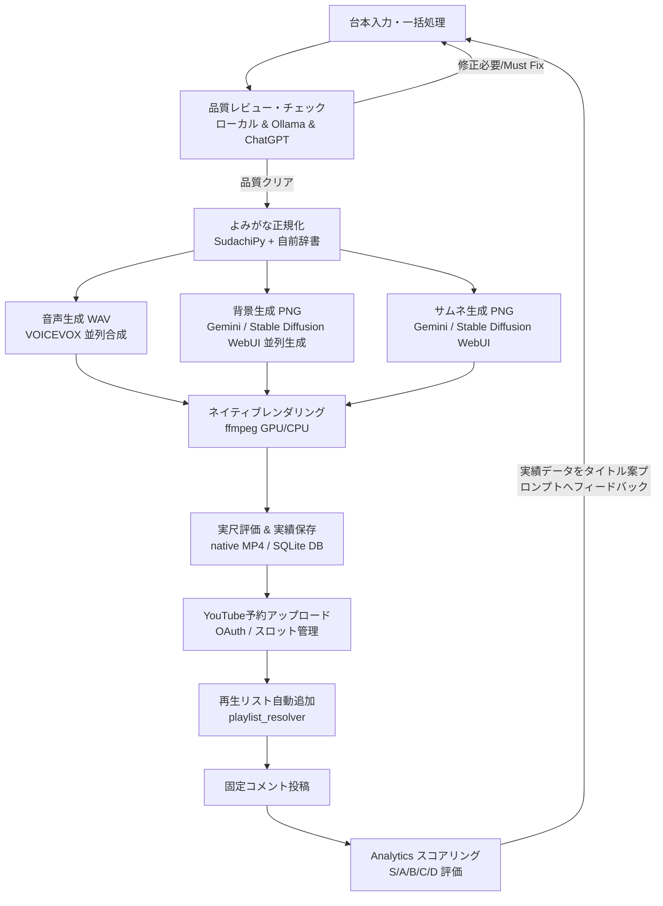

<div align="center">
  <h1>🎥 Native Video Factory</h1>
  <p><strong>「ずんだもんとめたんの食べ物雑学堂」向け、台本からの全自動動画生成・投稿システム</strong></p>

  
  
  
  
</div>

<br />

> 台本を入力するだけで、**VOICEVOXによる音声合成**、**Nano Banana / Stable Diffusion WebUI による背景画像・サムネイル生成**、**ffmpegによる高品質なネイティブMP4動画のレンダリング**、そして**YouTubeへの予約投稿・アナリティクス分析**までをシームレスに行うことができるローカルWebツールです。

---

## 📑 目次

- [🔄 システム処理フロー](#-システム処理フロー)
- [🚀 クイックスタート](#-クイックスタート)
- [🛠 前提条件](#-前提条件-prerequisites)
- [📦 セットアップ手順](#-セットアップ手順)
- [💻 起動方法と起動オプション](#-起動方法と起動オプション)
- [🖥️ Web UI 画面一覧](#️-web-ui-画面一覧)
- [📝 基本のワークフロー](#-基本のワークフロー)
- [📜 台本フォーマット](#-台本フォーマット)
- [▶️ YouTube 再生リスト自動登録](#️-youtube-再生リスト自動登録)
- [⚙️ 主な設定値](#️-主な設定値)
- [📁 フォルダ構成](#-フォルダ構成)
- [🛟 トラブルシューティング](#-トラブルシューティング)
- [⚠️ 注意・制約事項](#️-注意制約事項)
- [📢 CTA/Long動画の運用ポリシー](#-ctalong動画の運用ポリシー)
- [🖥 開発環境](#-開発環境)

---

## 🔄 システム処理フロー

本システムは、以下のパイプラインに沿って動画を完全自動で生成・投稿します。



---

## 🚀 クイックスタート

1. **VOICEVOX を起動**しておきます（デフォルトポート: `50021`）。
2. リポジトリ直下の起動スクリプトをダブルクリック、またはターミナルから起動します。

   **Windows:**
   ```powershell
   .\start.ps1
   ```
   **macOS:**
   ```bash
   ./start.command
   ```
3. 自動的にブラウザが立ち上がり、`http://127.0.0.1:58080` にアクセスできます。

> [!NOTE]
> 開発時（ソースコード変更を自動反映したい場合）は `start-dev.ps1` / `start-dev.command` を使ってください（`--reload` 付き）。

---

## 🛠 前提条件 (Prerequisites)

| ソフトウェア | 用途 | 備考 |
|:---|:---|:---|
| **Python 3.10+** | 実行環境 | `.venv` 仮想環境を使用 |
| **VOICEVOX** | 音声合成 | デフォルトポート `50021` |
| **ffmpeg** | 動画レンダリング | `h264_nvenc`（GPU）または `libx264`（CPU）|
| **Ollama** | 台本品質レビュー | デフォルトモデル: `qwen3:8b` |
| **Google AI Studio** | 背景・台本生成 | `GOOGLE_API_KEY` 必須 |

---

## 📦 セットアップ手順

### Step 1. 仮想環境と依存パッケージの準備

**仮想環境の作成:**

**Windows:**
```powershell
py -3 -m venv .venv
```

**macOS:**
```bash
python3 -m venv .venv
```

**依存関係のインストール:**

```powershell
# Windows (PowerShell)
.venv\Scripts\Activate.ps1
pip install --upgrade -r config/requirements.txt
```
```bash
# macOS
.venv/bin/python -m pip install --upgrade -r config/requirements.txt
```

### Step 2. 認証情報の登録（DB暗号化保存）

認証情報はすべて **設定画面 `/settings` の「認証情報」セクション** から登録します。
`.env` への直接記入は不要です（旧方式。後述の移行手順を参照）。

| 項目 | 用途 |
|:---|:---|
| Google API Key | Gemini API（台本・背景画像・サムネイル生成） |
| OpenAI API Key | ChatGPT（台本の生成前最終レビュー） |
| HF Token | Hugging Face（Stable Diffusion WebUI モデル自動DL） |
| YouTube Client Secrets | OAuth 2.0 クライアント設定（JSON文字列） |
| YouTube Upload OAuth | アップロード用トークン（認証ボタンから取得） |
| YouTube Analytics OAuth | Analytics取得用トークン（認証ボタンから取得） |

認証情報は `data/settings.db` の `encrypted_secrets` テーブルに **AES-GCM** で暗号化して保存されます。
Windows では DPAPI によりログインユーザーのみが復号できます。

#### 既存 `.env` / OAuth ファイルからの移行

旧方式（`.env` に直接記入 / `client_secrets.json` 等を配置）を利用中の場合は、
**アプリ起動時に自動移行**されます（値はそのまま DB に保存されます）。

移行後は設定画面で「旧認証ファイル削除」ボタンから安全に削除できます。

### Step 3. YouTube OAuth 設定

1. Google Cloud Console で OAuth 2.0 クライアントを作成し、JSONをコピーする。
2. 設定画面 `/settings` の「認証情報」→「YouTube Client Secrets 登録」に貼り付けて保存する。
3. 「YouTube Upload OAuth 認証開始」ボタンでブラウザ認証を完了するとトークンが DB に保存される。
4. Analytics 利用時は「YouTube Analytics OAuth 認証開始」ボタンで同様に認証する。

> [!NOTE]
> `token.json` / `token_analytics.json` は恒久ファイルとして新規作成されません。
> OAuth トークンはリフレッシュのたびに DB へ自動再保存されます。

> [!IMPORTANT]
> `.env` / `client_secrets.json` / `token.json` / `token_analytics.json` は**絶対に Git にコミットしないでください**（`.gitignore` 設定済み）。

### Step 4. Stable Diffusion WebUI を使う場合（任意）

Gemini の代わりにローカルで画像生成したい場合のみ設定します。

```env
IMAGE_BACKEND=sd_webui
SD_WEBUI_BASE_URL=http://127.0.0.1:7860
```

Stable Diffusion WebUI を `--api` オプション付きで起動してください。

---

## 💻 起動方法と起動オプション

### 通常起動（推奨）

```powershell
.\start.ps1         # Windows
./start.command     # macOS
```

### 手動起動（開発・デバッグ用）

```powershell
.\.venv\Scripts\python.exe -m web_app.app --open-browser
.\.venv\Scripts\python.exe -m web_app.app --reload --open-browser  # 自動リロード付き
```

### 主要な起動引数

| オプション | 説明 |
|:---|:---|
| `--port N` | ポートを指定（デフォルト: `58080`） |
| `--auto-port` | 競合時、自動的に次の空きポートを探す |
| `--open-browser` | 起動後に自動でブラウザを開く |
| `--reload` | ソース変更で自動再起動（開発向け） |

### 終了方法

- **Web UI から終了（推奨）:** ナビゲーションバー右端の「⏻ 終了」ボタンをクリック。動画生成中の場合は確認ダイアログが表示されます。ジョブがなければ即座に安全終了します。
- **ターミナルから終了:** 起動したターミナルで `Ctrl+C` を押すと安全に終了します（shutdown hook が実行されます）。

---

## 🖥️ Web UI 画面一覧

| URL | 画面名 | 主な用途 |
|:---|:---|:---|
| `/` | ホーム | 外部サービス（ffmpeg / VOICEVOX / SD WebUI）の起動状態確認 |
| `/generate` | 動画生成 | 台本貼り付け → 音声・画像・動画を一括生成 |
| `/check` | 台本チェック | 生成前の台本品質チェック・プリフライト |
| `/history` | 履歴一覧 | 生成済み動画の一覧・品質スコア確認 |
| `/history/{name}` | 履歴詳細 | 個別の動画確認・再生成・レンダー・アップロード |
| `/images` | 画像確認・再生成 | 背景画像・サムネイルの確認と個別再生成 |
| `/upload` | アップロード | 生成済み動画のYouTube一括アップロード |
| `/fixed-comment` | 固定コメント | 公開済み動画へのコメント投稿 |
| `/schedule` | スケジュール管理 | YouTube予約状態の確認・同期 |
| `/analytics` | Analytics | 視聴データ取得・スコアリング・実績参照 |
| `/db` | 動画DB | 全動画のDB検索・Analytics 履歴・レコード削除 |
| `/settings` | 設定 | 各種パラメータのGUI変更・チャンネル情報設定 |

---

## 📝 基本のワークフロー

1. **起動:** VOICEVOXを起動 → 起動スクリプトでWeb UIを開く
2. **実績同期:** `Analytics` で YouTube 視聴データを取得
3. **台本作成:** 実績を基に AI にタイトル案・台本を作成させる
4. **生成:** `/generate` で台本を貼り付け → `生成開始`
5. **確認:** `/images` で背景・サムネイルを確認・調整
6. **レンダー:** 履歴詳細の「動画再作成（レンダーのみ）」で確認後、MP4化
7. **アップロード:** 履歴詳細の「YouTubeにアップロード」または `/upload`（一括）
8. **コメント投稿:** `/fixed-comment` で固定コメントを投稿
9. **スケジュール確認:** `/schedule` でYouTube予約状態を同期

---

## 📜 台本フォーマット

台本テキストの先頭にメタ情報を定義し、空行を挟んでセリフ・演出を記述します。

### Shorts

```text
動画形式: Shorts
動画タイトル: チョコは500年間ずっと飲み物だった
サムネ文字: 飲み物
説明文: チョコレートの驚きの歴史を解説！
タグ: ずんだもん,ゆっくり解説,VOICEVOX,食べ物 雑学,雑学 ショート
再生リスト: 実は薬・毒扱いだった！食べ物の黒歴史

背景: 漫画風。中世ヨーロッパの薬草店。
ずんだもん(ノーマル): チョコは昔、薬の飲み物だったのだ！
四国めたん(ツンツン): えーっ！薬ですの！？
テロップ: 薬だった！
```

### Long（じっくり解説）

```text
動画形式: Long
動画タイトル: トマトが毒だと思われた黒歴史【じっくり解説】
説明文: なぜトマトは長年「毒」と信じられていたのか？
タグ: ずんだもん,ゆっくり解説,食べ物 雑学,長編
再生リスト: 実は薬・毒扱いだった！食べ物の黒歴史

チャプター:
00:00 イントロ
00:30 トマトの原産地
...

背景: 広大な農場。夕日。
ずんだもん(ノーマル): 今日のテーマはトマトの意外な歴史なのだ！
```

### ネタ会議

```text
動画形式: ネタ会議
画面形式: 縦
動画タイトル: 次に伸びる食べ物雑学ネタ会議
再生リスト: ずんだもんとめたんのネタ会議

候補番号: 1
候補タイトル: オイスターが昔は労働者の食べ物だった

背景: 漫画風会議室。
テロップ: ネタ会議スタート
ずんだもん(あまあま): さっそく候補ネタを発表するのだ！
```

### 記法一覧

| 記法 | 説明 |
|:---|:---|
| `(スタイル名)` | VOICEVOX のスタイル（例: `(ノーマル)` `(あまあま)` `(ツンツン)`） |
| `[表情名]` | native立ち絵の表情 PNG 指定（例: `[笑い]`） |
| `テロップ:` | セグメント冒頭にポップアップ表示するテキスト |
| `サムネイル:` | サムネイルに使う背景の指定 |
| `サムネ文字:` | サムネイルに表示する大きなテキスト |
| `再生リスト:` | アップロード先の再生リストカテゴリ名（カンマ区切りで複数可） |
| `━━ タイトル ━━` | 複数動画を1つのテキストで一括処理する区切り |

---

## ▶️ YouTube 再生リスト自動登録

台本に `再生リスト:` を記述するとアップロード時に自動登録されます。指定するのは**カテゴリ名**で、動画形式に応じて実際の YouTube 再生リスト名に解決されます。

| 動画形式 | カテゴリ名の例 | 解決後のYouTube再生リスト名 |
|:---|:---|:---|
| Shorts | 実は薬・毒扱いだった！食べ物の黒歴史 | `実は薬・毒扱いだった！食べ物の黒歴史 Shorts` |
| Long | 実は薬・毒扱いだった！食べ物の黒歴史 | `実は薬・毒扱いだった！食べ物の黒歴史【じっくり解説】` |
| ネタ会議（縦） | 任意 | `ずんだもんとめたんのネタ会議 Shorts` |
| ネタ会議（横） | 任意 | `ずんだもんとめたんのネタ会議【じっくり版】` |

再生リストが YouTube 上に存在しない場合は**自動作成**してから追加します。

**標準カテゴリ（7種）:**

1. なんで？食べ物の形・容器・袋の秘密
2. 昔は捨ててたのに今は高級品！食べ物の大逆転
3. 実は薬・毒扱いだった！食べ物の黒歴史
4. 実は日本生まれ！その名前、騙されてます
5. 海外では信じられない！ニッポン食のギャップ
6. 毎日使うのに知らない！調味料の意外すぎる秘密
7. コンビニ・スナック・チェーンの開発秘話

---

## ⚙️ 主な設定値

優先順位: **`data/settings.db`（設定画面で変更） > `config.py` の既定値**

認証情報（Google API Key / OpenAI API Key / HF Token / YouTube OAuth）は **設定画面 `/settings` の「認証情報」セクション** に登録し、`data/settings.db` の `encrypted_secrets` テーブルへ AES-GCM で暗号化保存されます。`.env` への直接記入は不要です。
それ以外の設定は `/settings` 画面で変更でき、`data/settings.db` に保存されます（再起動不要で即時反映）。

### AI モデル

| 設定項目 | 既定値 | 説明 |
|:---|:---|:---|
| `GEMINI_MODEL` | `gemini-3.1-pro-preview` | 台本生成モデル |
| `NANOBANANA_PRO_MODEL` | `gemini-3-pro-image-preview` | 背景・サムネ高品質モデル |
| `NANOBANANA_FLASH_MODEL` | `gemini-3.1-flash-image-preview` | 背景・サムネ高速モデル |
| `IMAGE_BACKEND` | `gemini` | 画像生成バックエンド（`gemini` / `sd_webui`） |

### VOICEVOX・音声

| 設定項目 | 既定値 | 説明 |
|:---|:---|:---|
| `VOICEVOX_URL` | `http://localhost:50021` | VOICEVOX API エンドポイント |
| `VOICEVOX_QUERY_WORKERS` | `4` | audio_query の並列数 |
| `VOICEVOX_SYNTH_WORKERS` | `2` | 音声合成の並列数 |
| `NATIVE_SHORTS_BODY_VOICE_SPEED` | `1.35` | Shorts 本編音声速度 |
| `NATIVE_LONG_BODY_VOICE_SPEED` | `1.2` | Long 本編音声速度 |

### 画像生成

| 設定項目 | 既定値 | 説明 |
|:---|:---|:---|
| `NANOBANANA_BG_WORKERS` | `3` | Nano Banana 背景生成並列数 |
| `MAX_BACKGROUNDS_SHORTS` | `9` | Shorts 1本あたりの最大背景枚数 |
| `MAX_BACKGROUNDS_LONG` | `16` | Long 1本あたりの最大背景枚数 |
| `WEB_DEFAULT_SD_SIZE_MODE` | `true` | 縮小生成をデフォルトにする（ONで縮小・OFFでFHD） |
| `SD_SIZE_IMAGE_SCALE` | `0.5` | 縮小生成時の倍率（0.5 = 50%サイズで生成後にffmpegで拡大） |

### 動画・字幕

| 設定項目 | 既定値 | 説明 |
|:---|:---|:---|
| `NATIVE_FFMPEG_ENCODER` | `h264_nvenc` | ffmpegエンコーダ（GPU: `h264_nvenc` / CPU: `libx264`） |
| `NATIVE_SUBTITLE_FONT` | `ラノベPOP v2` | 字幕フォント名 |
| `NATIVE_SUBTITLE_FONT_SIZE_SHORTS` | `64` | Shorts 字幕基本フォントサイズ (px) |
| `NATIVE_SUBTITLE_FONT_SCALE` | `1.4` | フォントサイズ倍率 |
| `NATIVE_SUBTITLE_WRAP_CHARS_SHORTS` | `13` | Shorts 字幕の1行最大文字数（超えると自動折り返し） |
| `NATIVE_SUBTITLE_WRAP_CHARS_LONG` | `24` | Long 字幕の1行最大文字数 |

### チャンネル識別情報

複数チャンネルを別 clone で運用する際の操作ミス防止用。設定画面の「チャンネル」グループで変更可能。

| 設定項目 | 必須 | 説明 |
|:---|:---|:---|
| `CHANNEL_NAME` | アップロード時必須 | チャンネル表示名。未設定時はアップロード禁止。 |
| `CHANNEL_HANDLE` | アップロード時必須 | `@` から始まるハンドル（`@` は省略可、自動補完）。 |
| `CHANNEL_THEME` | 任意 | テーマ説明（バナー表示のみ）。 |
| `CHANNEL_ACCENT_COLOR` | 任意 | UI アクセント色（`#RRGGBB`）。 |
| `DEFAULT_HASHTAGS` | 任意 | デフォルトハッシュタグ。 |

### Web UI 既定値

| 設定項目 | 既定値 | 説明 |
|:---|:---|:---|
| `WEB_UI_PORT` | `58080` | Web UI ポート番号 |
| `WEB_DEFAULT_REUSE_BACKGROUNDS` | `false` | 「背景を再利用する」チェックの既定 |
| `WEB_DEFAULT_LONG_THUMBNAIL_AB_TEST` | `false` | Long サムネ A/B テストの既定 |
| `LONG_UPLOAD_PLAYLIST_NAME` | `` | `再生リスト:` 未指定時のLong動画デフォルト再生リスト名（空=無効） |

---

## 📁 フォルダ構成

```
.
├── config/
│   ├── config.py              # 全設定値の定義（os.environ.get ベース）
│   ├── requirements.txt       # Python依存パッケージ
│   ├── script_generation_prompt.txt  # Gemini台本生成プロンプト
│   └── prompt_parts/          # 台本生成プロンプト部品
│       ├── local/             # 個人用（.gitignore 対象）
│       └── samples/           # サンプル（リポジトリ管理）
├── core/
│   ├── metadata_db.py         # SQLite メタデータDB（schema v4）
│   ├── settings_store.py      # SQLite 設定DB（data/settings.db）
│   ├── channel_info.py        # チャンネル識別情報の読み込み・検証
│   ├── native_renderer.py     # ffmpeg MP4レンダラー
│   ├── voicevox.py            # VOICEVOX音声生成
│   ├── image_generator.py     # 背景・サムネイル生成（Nano Banana）
│   ├── parser.py              # 台本パーサー（ScriptParser）
│   ├── ai_generator.py        # Gemini台本生成・画像プロンプト強化
│   ├── analytics_score.py     # Analytics スコアリング・DBへの保存
│   ├── opening_quality.py     # 冒頭品質レビュー（ローカル+Ollama+ChatGPT）
│   ├── cta_policy.py          # CTA許可/禁止ポリシー判定・DB読み書き
│   ├── upload_scheduler.py    # アップロードスロット管理
│   ├── upload_records.py      # アップロード記録（DBクエリラッパー）
│   ├── playlist_resolver.py   # 再生リスト名解決・動画形式判定
│   ├── youtube_uploader.py    # YouTubeアップロード・再生リスト操作
│   ├── youtube_analytics.py   # YouTube Analytics API取得
│   ├── reading_normalizer.py  # VOICEVOX読み仮名補正
│   ├── script_prompts.py      # Gemini台本生成プロンプト構築
│   ├── output_paths.py        # 出力パスの集約
│   └── app_shutdown.py        # アプリ終了管理
├── workers/
│   ├── main.py                # 動画生成パイプライン本体
│   ├── worker_pipeline.py     # パイプライン分割処理
│   └── worker_render.py       # レンダリング処理
├── web_app/
│   ├── app.py                 # FastAPI エントリポイント
│   ├── job_manager.py         # バックグラウンドジョブ管理（DB永続化）
│   ├── routes/                # APIルーター群
│   ├── services/              # ビジネスロジック
│   ├── templates/             # Jinja2 HTMLテンプレート
│   └── static/                # CSS / JS / 画像
├── tests/                     # ユニットテスト
├── scripts/
│   └── migrate_folder_prefixes.py  # 旧フォルダプレフィックス移行スクリプト
├── assets/
│   ├── bgm/                   # BGM音源
│   ├── characters/            # キャラクター立ち絵
│   ├── nanobanana/            # 画像生成テンプレート
│   └── se/                    # 効果音
├── data/                      # アプリデータ（一部 .gitignore 対象）
│   ├── settings.db            # 設定DB（.gitignore 対象）
│   ├── reading_dictionary_base.json   # よみがな補正辞書（同梱）
│   └── reading_dictionary_user.json  # ユーザー追加辞書（.gitignore 対象）
├── output/                    # 生成物（.gitignore対象）
│   ├── {テーマ名}/
│   │   ├── script.txt         # 台本
│   │   ├── {テーマ名}_native.mp4
│   │   ├── thumbnails/
│   │   ├── audio/
│   │   ├── backgrounds/
│   │   └── _meta/             # ※JSON管理廃止。内容はすべてDBに保存
│   ├── 000_data/
│   │   └── metadata.db        # 動画メタデータ・Analytics・ジョブ履歴DB
│   └── 000_uploaded/          # アップロード済みフォルダの移動先
├── start.ps1                  # Windows起動スクリプト（通常用）
├── start-dev.ps1              # Windows起動スクリプト（開発用）
├── start.command              # macOS起動スクリプト
└── .env                       # 認証情報のみ（GOOGLE_API_KEY 等）
```

> **DB について**: 設定・動画メタデータ・Analytics・ジョブ履歴はすべて SQLite で管理。
> `_meta/*.json` への書き込みは廃止済み。詳細は [SPEC.md](SPEC.md) の「DB アーキテクチャ」を参照。

---

## 🛟 トラブルシューティング

### 音声が生成されない

- VOICEVOX が起動しているか確認（`http://localhost:50021` にアクセスできるか）
- `/settings` 画面の「VOICEVOX API URL」が正しいか確認

### 画像が生成されない（Nano Banana）

- 設定画面 `/settings` の「認証情報」で **Google API Key が「登録済み」**になっているか確認
- API クォータ（レート制限）に引っかかっている場合は `NANOBANANA_BG_WORKERS` を `1` に下げる

### GPU エンコードが使われない

- ホーム画面でエンコーダの利用可否を確認
- `h264_nvenc` が利用不可の場合は ffmpeg が自動で `libx264`（CPU）にフォールバックします（ログに `⚠ GPUエンコードに失敗したため libx264 で続行しました` と表示）
- `.env` に `NATIVE_FFMPEG_ENCODER=libx264` を明示してCPUエンコードに固定することも可能

### アップロード後に「履歴が見つかりません」

- アップロード完了後、フォルダは `output/000_uploaded/` に移動されますが、履歴詳細ページはフォールバック検索するため自動的に表示されます。表示されない場合はページを再読み込みしてください。

### YouTube OAuth 認証エラー

設定画面 `/settings` の「認証情報」で YouTube Upload OAuth または YouTube Analytics OAuth を削除し、
「認証開始」ボタンで再認証してください。

> [!NOTE]
> `token.json` / `token_analytics.json` は使用されなくなりました。
> 旧ファイルが残っている場合は設定画面の「旧認証ファイル削除」から削除できます。

### 字幕が1行に収まらない・見切れる

`NATIVE_SUBTITLE_WRAP_CHARS_SHORTS`（デフォルト: 13）を調整してください。`0` に設定すると折り返しなし（無効）になります。

### アプリが終了できない・「⏻ 終了」ボタンで終了されない

- 動画生成中（worker が稼働中）の場合は、終了ボタンを押すと「停止して終了しますか？」という確認ダイアログが表示されます。「停止して終了」を選択すると worker が強制停止されてからアプリが終了します。
- ターミナルが利用可能な場合は `Ctrl+C` でも安全に終了できます。

---

## ⚠️ 注意・制約事項

- **ローカル限定:** Web UI は `127.0.0.1` のみバインドします。外部公開しないでください。
- **外部API費用:** ChatGPT API と Google Gemini API は費用が発生します。不要なAPIコールを避けるため、生成は1本ずつ確認しながら行うことを推奨します。
- **アップロードは破壊的操作:** 公開後の動画IDは変更できません。テスト用チャンネルで動作確認してから本番運用してください。

---

## 📢 CTA/Long動画の運用ポリシー

- **Shorts本編のループ視聴優先:** 直接的な誘導セリフは警告対象。「ネタ募集CTA」は既定で5本に1本のみ許可。
- **Long動画の目次:** 概要欄用の `【目次】(0:00形式)` チャプターマーカーを自動追加。
- **Longサムネイル A/B テスト:** 3パターンのサムネイル画像を自動出力し YouTube Studio でのテストをサポート。

---

## 🖥 開発環境

本プロジェクトの主開発機（Windows）の環境です。

| 項目 | 詳細 |
|:---|:---|
| OS | Windows 11 Home |
| CPU | Intel Core 7 240H（10コア / 16スレッド） |
| RAM | 32 GB |
| GPU | NVIDIA GeForce RTX 5060 Laptop GPU（NVENC 対応） |
| Python | 3.11.9（`.venv` 仮想環境） |
| ffmpeg | 8.0.1 full build（[gyan.dev](https://www.gyan.dev/ffmpeg/builds/) 版） |
| デフォルトエンコーダ | `h264_nvenc`（GPU） |

<details>
<summary><b>主要 Python パッケージ・連携アプリのバージョン</b></summary>

**Python パッケージ（`.venv` 内）**

| パッケージ | バージョン |
|:---|:---|
| FastAPI | 0.136.3 |
| Starlette | 1.1.0 |
| Uvicorn | 0.48.0 |
| google-genai | 1.75.0 |
| SudachiPy | 0.6.11 |
| Pillow | 12.2.0 |
| httpx | 0.28.1 |

**連携アプリ**（別プロセスとして起動）

| アプリ | バージョン | エンドポイント |
|:---|:---|:---|
| VOICEVOX | 0.25.2 | `http://localhost:50021` |
| Ollama | 0.24.0 | `http://localhost:11434` |
| Stable Diffusion WebUI | v1.10.1 | `http://localhost:7860`（任意） |

**Ollama インストール済みモデル**

| モデル | サイズ |
|:---|---:|
| qwen3:8b（デフォルト） | 4.9 GB |
| qwen2.5:7b-instruct | 4.4 GB |
| llama3:latest | 4.3 GB |
| gemma3:1b | 0.8 GB |
| gemma4:e2b | 6.7 GB |
| gemma4:e4b / latest | 8.9 GB |
| glm-4.7-flash:latest | 17.7 GB |
| gpt-oss:20b | 12.8 GB |

</details>

> [!NOTE]
> macOS 環境での動作については [クイックスタート](#-クイックスタート) および [セットアップ手順](#-セットアップ手順) の macOS 向け手順を参照してください。
