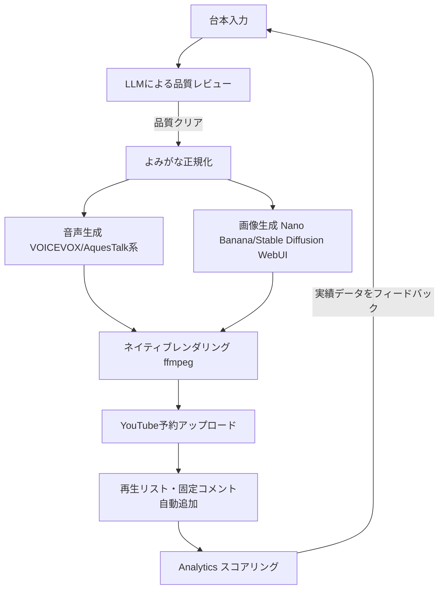

<div align="center">
  <h1>🎥 PicoCast</h1>
  <p><strong>複数YouTubeチャンネル対応の台本生成→動画→アップロード→Analytics確認までを行うローカルWebツール</strong></p>

  
  
  
  
</div>

フォルダは `C:\00_PG\22_PicoCast` へ改名済みです。改名コマンドの再実行や旧フォルダの作り直しは不要です。作業の再開は [HANDOFF.md](HANDOFF.md)、着手順と完了条件は [実装計画](DESIGN_implementation_plan.md) を参照してください。

Rust版への移行を進めています。共通基盤は `crates/`、検証入口は `cargo xtask verify` です。現在の運用は下記のPython旧版を使います。フォルダ・旧環境の移行状況と未確認事項は [R0実装状況](docs/r0-foundation.md)、完成形は [Rust作り直し設計](DESIGN_rust_rewrite.md) を参照してください。Rust版だけで動画を生成できる状態にはまだなっていません。

Rust共通ログは日付・総容量で整理し、異常終了の記録を次回起動へ保持します。設定・初期化・通知APIは [共通ログ](docs/logging.md) を参照してください。本番画面への接続は後続WPで行います。

Rust版のDBは、同期フォルダ・ネットワーク・FAT32など危険な保存先を既定で拒否します。開発版との分離と明示許可の境界は [保存先の安全確認](docs/storage-safety.md) を参照してください。

Rust版のエラーは日本語カタログから安定したコード・説明・対処を取得します。`cargo xtask catalog-check` と `docs-check` はコード/文言の欠損や文書リンクを検査し、`verify` にも含まれます。

旧版の機能・API・画面・設定・DB表の対応先は [移行棚卸し](docs/migration-inventory.md) に集約しています。`cargo xtask inventory` はソースと642項目の一致を確認します。

2026-10-16時点でローカルフォルダは `C:\00_PG\22_PicoCast` へ改名済みです。保管用の `legacy/` は作らず、Rust版への切り替え後は不要な旧コードを削除してGit履歴で参照します。DB・生成物・認証情報は別に保護します。Claude Remote Controlも `PicoCast` 名で新しいフォルダを参照し、既存のログオンタスク `Claude Remote Control - Projects` から起動します。

<br />

> 台本を入力するだけで、**VOICEVOX / AquesTalk系による音声合成**、**AIによる背景画像・サムネイル生成**、**ffmpegによる高品質なMP4動画のレンダリング**、そして**YouTubeへの予約投稿・アナリティクス分析**までをシームレスに行うことができるローカルWebツールです。

---

## 📑 目次

- [🚀 クイックスタート](#-クイックスタート)
- [✨ 主な機能・特徴](#-主な機能特徴)
- [🔄 システム処理フロー](#-システム処理フロー)
- [🛠 前提条件](#-前提条件-prerequisites)
- [💻 動作環境](#-動作環境)
- [📦 セットアップ手順](#-セットアップ手順)
- [💻 起動方法と起動オプション](#-起動方法と起動オプション)
- [📝 基本のワークフロー](#-基本のワークフロー)
- [🏷 製品版MVP運用](#-製品版mvp運用)
- [🖥️ Web UI 画面一覧](#️-web-ui-画面一覧)
- [📁 フォルダ構成](#-フォルダ構成)
- [🗄 データと保存場所](#-データと保存場所)
- [🛟 トラブルシューティング](#-トラブルシューティング)
- [⚠️ 注意・制約事項](#️-注意制約事項)
- [🖥 開発環境](#-開発環境)

> [!NOTE]
> 台本の記述フォーマット、各種設定値の詳細、システムの詳細な仕様については **[SPEC.md](SPEC.md)** を参照してください。
> 日々の具体的な操作手順については **[MANUAL.md](MANUAL.md)** を参照してください。

---

## 🚀 クイックスタート

1. **VOICEVOX を起動**しておきます（デフォルトポート: `50021`）。
2. リポジトリ直下の起動スクリプトをダブルクリック、またはターミナルから起動します。

   **Windows:**
   ```powershell
   .\start.ps1
   ```
   **macOS:**
   ```bash
   ./start.command
   ```
3. 自動的にブラウザが立ち上がり、システムにアクセスできます。
4. Web UI起動時に job-runner も自動起動します。runner は `metadata.db` のキューを監視し、Webとは別プロセスで生成・レンダーを実行します。
5. 新規環境では `/setup` に誘導されます。チャンネル、APIキー、外部サービス診断、BGM、サンプル生成を順に確認してください。

> [!TIP]
> 開発時（ソース変更を即時反映したい場合）は `start-dev.ps1` / `start-dev.command` を使ってください。

---

## 🔄 システム処理フロー



---

## ✨ 主な機能・特徴

- 🎬 台本から動画を全自動生成（音声・背景・字幕・BGM・サムネイル・MP4）
- 🗣 VOICEVOX / AquesTalk系 音声合成＋よみがな自動補正
- 🖼 AI 画像生成（Gemini ⇄ Stable Diffusion WebUI 切替）
- 🧠 台本の品質レビュー・自動リライト
- 📅 YouTube 連携（予約投稿・再生リスト登録・固定コメント投稿）
- 📊 Analytics 連携（視聴データを次の台本に反映）
- 🔀 複数チャンネル対応
- 🤖 チャンネル別フルオート運用（ネタ選定 → 台本 → 音声・画像 → MP4 → 品質判定 → 投稿予約 → 分析）

### フルオート運用

「設定」またはヘッダーの「自動運用」から、チャンネルごとのShorts / Longの1日あたりの生成本数、生成開始時刻、品質の最低点、有料APIの1日上限回数を設定します。初期値はShorts 1本・Long 0本・6時開始・80点以上で、運用は停止中です。有料API上限は初期値0のため、明示設定と投稿予約の確認が済むまで開始しません。

Google AI、YouTube投稿、YouTube Analyticsの認証と、既存の動画生成環境（VOICEVOX・画像エンジン・ffmpeg・Ollama）が必要です。PCとアプリが起動している間、runnerが設定を読み直して各チャンネルの工程を実行します。過去日の未実行枠を一括で埋める運用はしません。投稿時刻はチャンネルの予約スロットに従い、空き枠へ割り当てるため、生成本数と当日の公開本数は異なる場合があります。

品質不足、API上限到達、通信失敗、実行結果が不明な工程は保留し、そのチャンネルの後続運用も止めます。画面から原因・成果物・YouTube Studioを確認し、「この枠を終了」で保留枠を終了できます。途中の完了済み工程はDBに保存し、未着手の工程から続行します。中断した生成・投稿を無条件で再実行しません。

有料API上限はGoogle AI（台本・補助処理・画像）とOpenAIのアプリ側呼び出し回数を合算します。SDK内の通信再試行や提供元の課金単位を含む金額上限ではありません。投稿予約を伴う自動運用の有効化には画面の確認ダイアログが必要です。実行中に設定を変更するとその運用枠を保留する場合があります。停止操作は次の工程やキャンセル確認に反映され、既に送信済みの投稿予約は取り消しません。

---

## 🛠 前提条件 (Prerequisites)

| ソフトウェア | 用途 | 備考 |
|:---|:---|:---|
| **Python 3.10+** | 実行環境 | `.venv` 仮想環境を使用 |
| **VOICEVOX** | 音声合成 | デフォルトポート `50021` |
| **AquesTalk系エンジン** | ゆっくり音声合成 | 任意。利用時はA-Quest公式ライセンス確認が必要 |
| **ffmpeg** | 動画レンダリング | `h264_nvenc`（GPU）または `libx264`（CPU）|
| **Ollama** | 品質レビュー等 | デフォルトモデル: `qwen3:8b` |
| **Google AI Studio** | 台本・Gemini画像生成 | APIキーは設定画面で登録 |

### 必須構成 早見表

使い方によって必要なソフト・APIキーが変わります。**VOICEVOX と ffmpeg は常に必須**です（✅必須 ／ △任意 ／ —不要）。

| 使い方 | VOICEVOX | ffmpeg | Google APIキー | Stable Diffusion WebUI | Ollama |
|:---|:---:|:---:|:---:|:---:|:---:|
| 手書き台本 ＋ Stable Diffusion WebUI 画像（**最小構成**） | ✅ | ✅ | — | ✅ | ✅ |
| 手書き台本 ＋ Gemini 画像 | ✅ | ✅ | ✅ | — | △ |
| AI台本生成 ＋ Gemini 画像 | ✅ | ✅ | ✅ | — | △ |
| AI台本生成 ＋ Stable Diffusion WebUI 画像 | ✅ | ✅ | ✅（台本用） | ✅ | ✅ |

- **YouTube 認証**：YouTube へアップロードする場合のみ必須（生成だけなら不要）。
- **Ollama**：Stable Diffusion WebUI 画像のプロンプト英訳に必須。台本の品質レビューは任意。
- **OpenAI APIキー**＝台本の最終レビュー用（任意）、**HF Token**＝Stable Diffusion WebUI のモデルDL用（任意）。

> [!NOTE]
> Google APIキーは「AI台本生成」または「Gemini画像生成」を使うときだけ必要です。**台本を手書きし、画像を Stable Diffusion WebUI で作るなら不要**です。同じ早見表は初回セットアップ（`/setup`）の冒頭にも表示されます。

---

## 💻 動作環境

Native Video Factory はローカルPC上で動作する Web UI アプリです。
動画生成には VOICEVOX、ffmpeg、各種APIキー、必要に応じて Ollama や Stable Diffusion WebUI を使用します。

画像生成を Google AI画像生成モードで行う場合は、高性能GPUは必須ではありません。
一方、Stable Diffusion WebUI によるローカル画像生成を使う場合は、GPU性能とメモリ容量の影響が大きくなります。

### Windows版

| 区分 | 最低動作環境 | 推奨環境 | ローカル画像生成も使う場合 |
|---|---|---|---|
| OS | Windows 10 / 11 64bit | Windows 11 64bit | Windows 11 64bit |
| CPU | 4コア / 8スレッド以上 | 6コア以上 | 8コア以上 |
| メモリ | 16GB以上 | 32GB以上 | 32〜64GB推奨 |
| GPU | 不問 | NVIDIA GPU推奨 | NVIDIA RTX系推奨 |
| VRAM | 不問 | 6GB以上推奨 | 8GB以上、できれば12GB以上 |
| ストレージ空き | 20GB以上 | 50GB以上 | 100GB以上 |
| ストレージ種別 | SSD推奨 | SSD推奨 | NVMe SSD推奨 |
| ネット接続 | 必須 | 必須 | 必須 |

#### Windows版の補足

- Google AI画像生成モードでは、画像生成はクラウドAPI側で行われるため、高性能GPUは必須ではありません。
- Stable Diffusion WebUI によるローカル画像生成を使う場合は、NVIDIA GPU と十分なVRAMを推奨します。
- メモリ8GB以下、HDD環境、内蔵GPUのみでのローカル画像生成は推奨しません。
- 快適に利用するにはメモリ32GB以上を推奨します。

### Mac版

| 区分 | 最低動作環境 | 推奨環境 | ローカル画像生成も使う場合 |
|---|---|---|---|
| OS | macOS 13 Ventura 以降 | macOS 14 Sonoma 以降 | macOS 14 Sonoma 以降 |
| CPU | Apple M1 以降 | Apple M2 / M3 以降 | Apple M3 Pro / M4 Pro 以上推奨 |
| Intel Mac | 非推奨 | 非推奨 | サポート対象外または非推奨 |
| メモリ | 16GB以上 | 24〜32GB以上 | 32GB以上推奨 |
| GPU | Apple Silicon 内蔵GPU | Apple Silicon 内蔵GPU | Apple Silicon 上位GPU推奨 |
| ストレージ空き | 20GB以上 | 50GB以上 | 100GB以上 |
| ストレージ種別 | SSD必須 | SSD推奨 | SSD必須 |
| ネット接続 | 必須 | 必須 | 必須 |

#### Mac版の補足

- Mac版は Apple Silicon Mac 向けを基本とします。
- Google AI画像生成モードでの利用を推奨します。
- Macで Stable Diffusion WebUI を使う場合、Windows + NVIDIA GPU環境より導入や生成速度の面で不利になる場合があります。
- ローカル画像生成は上級者向け機能として扱ってください。
- 快適に利用するには Apple Silicon Mac、メモリ24GB以上を推奨します。

### 必要な外部ソフト・サービス

| 項目 | 必須/任意 | 用途 |
|---|---|---|
| VOICEVOX | 必須 | ずんだもん・四国めたん等の音声合成 |
| AquesTalk系エンジン | 任意 | ゆっくり霊夢風・ゆっくり魔理沙風などの音声合成 |
| ffmpeg | 必須 | native MP4 の動画出力 |
| Google APIキー | Google AI画像生成・Gemini台本生成で必要 | 台本生成・背景画像生成・サムネイル生成 |
| OpenAI APIキー | 任意 | ChatGPT生成前レビュー |
| Ollama | 任意 / 一部機能で必要 | 冒頭レビュー、リライト、Stable Diffusion WebUI用プロンプト翻訳、ジャンル別再生リスト判定 |
| Stable Diffusion WebUI | 任意 | ローカル画像生成 |
| YouTube API連携 | 任意 | YouTubeアップロード、予約投稿、Analytics取得 |

### 注意事項

- 生成速度はPC性能、画像枚数、API混雑、VOICEVOXやOllamaの状態によって変わります。
- Ollamaによるカテゴリ判定は、独立した「再生リスト振り分け」画面で手動実行します。「再生リスト未登録のみ実行」を選択でき、生成・レンダー・アップロード処理からは呼び出されません。
- Google AI画像生成モードではAPI利用料金が発生する場合があります。
- YouTube連携を使う場合は、利用者自身のGoogle Cloud設定とOAuth認証が必要です。
- Stable Diffusion WebUI を利用する場合は、別途セットアップとモデルの準備が必要です。
- AquesTalk系エンジンを使う場合は、VOICEVOXとは別に [A-Quest公式ライセンス](https://store.a-quest.com/items/7413986) を確認してください。YouTube収益化や商用利用では利用者自身でライセンス条件を満たす必要があります。
- 霊夢・魔理沙など東方Project由来のキャラ名や立ち絵を使う場合は、[東方Projectの二次創作ガイドライン](https://touhou-project.news/guideline/) と [動画配信サービスへの投稿に関するガイドライン](https://touhou-project.news/guideline_videoposting/) を確認してください。
- 本アプリはローカルPC上で動作しますが、外部APIを利用する機能ではインターネット接続が必要です。

---

## 📦 セットアップ手順

### Step 1. 仮想環境と依存パッケージの準備

**Windows:**
```powershell
py -3 -m venv .venv
.venv\Scripts\Activate.ps1
pip install --upgrade -r config/requirements.txt
```

**macOS:**
```bash
python3 -m venv .venv
source .venv/bin/activate
pip install --upgrade -r config/requirements.txt
```

テストを実行する開発環境では、追加で開発用依存を入れます。

```powershell
pip install --upgrade -r config/requirements-dev.txt
```

### Step 2. 認証情報の登録

認証情報はすべて **設定画面の「APIキー」タブ** から登録します。
情報は active channel profile ごとにデータベースへ暗号化保存されるため、チャンネルを切り替えて個別に管理できます。
チャンネルの `profile_id` / `genre_profile` / `output_root` はチャンネルハンドル（`@` なし）で統一されます。
チャンネル詳細画面から、そのチャンネル専用の APIキー・YouTube Client Secrets を登録できます。
投稿予約スロットもチャンネル別に管理されます。既定値は全チャンネル共通で、Shorts が 12:00 / 21:00、Long が 22:00、タイムゾーンは Asia/Tokyo です。

| 項目 | 用途 |
|:---|:---|
| **Google API Key** | Gemini API（台本・背景・サムネイル生成） |
| **OpenAI API Key** | ChatGPT（台本の最終レビュー） |
| **HF Token** | Hugging Face（Stable Diffusion WebUI モデルDL用・任意） |
| **YouTube Client Secrets** | OAuth クライアント情報（JSON文字列） |

> [!IMPORTANT]
> OAuthやAPIキーを含んだファイル（`.env` 等）は **絶対に Git にコミットしないでください**。認証情報の正本は `data/settings.db` の暗号化テーブルです。

### Step 3. YouTube OAuth 認証

1. Google Cloud Console で OAuth 2.0 クライアントを作成し、JSONをコピーする。
2. 設定画面の「YouTube Client Secrets 登録」に貼り付けて保存する。
3. アップロード用およびアナリティクス用の認証ボタンを押し、ブラウザでGoogleアカウント認証を完了する。

---

## 💻 起動方法と起動オプション

### 通常起動（推奨）

```powershell
.\start.ps1         # Windows
./start.command     # macOS
```

### 手動起動・オプション

```powershell
.\.venv\Scripts\python.exe -m web_app.app --open-browser
```

| オプション | 説明 |
|:---|:---|
| `--port N` | ポートを指定（デフォルト: `58080`） |
| `--auto-port` | 競合時、自動的に次の空きポートを探す |
| `--open-browser` | 起動後に自動でブラウザを開く |
| `--reload` | ソース変更で自動再起動（開発向け） |

### 終了方法

Web UI は起動時に表示される `127.0.0.1`（または同じポートの `localhost`）で開いてください。変更操作は画面の Origin と起動ごとのセッショントークンで保護しています。アプリを起動し直した後に操作が拒否された場合は、画面を再読み込みしてください。

- **Web UI から終了:** 画面右上の「⏻ 終了」ボタンをクリック。
- **ターミナルから終了:** `Ctrl+C` を押すと安全に終了処理（shutdown hook）が実行されます。

---

## 📝 基本のワークフロー

※詳細は **[MANUAL.md](MANUAL.md)** をご覧ください。

1. **実績同期:** アナリティクス画面で YouTube の視聴データを取得。
2. **台本作成:** 実績を基にプロンプトを生成し、AIに台本を作成させる。
3. **動画生成:** 動画生成画面に台本を貼り付け、「生成開始」を実行。
4. **素材確認:** 画像確認画面や履歴詳細から、背景・サムネイルを確認。必要なら手動差し替えも可能。
5. **レンダリング:** 履歴詳細の「動画再作成（レンダーのみ）」で、選択したBGMを使ってMP4化。
6. **アップロード:** アップロード画面から一括でYouTubeへ予約投稿。
7. **コメント投稿:** 固定コメント画面で、公開済み動画へコメントを投稿。

---

## 🏷 製品版MVP運用

- 初回セットアップ状態は `data/settings.db:settings` に保存します。未完了時は生成・アップロードをブロックします。
- ライセンス未登録・端末未登録時は体験版（`trial`）として扱い、native MP4 に小さな透かしを入れます。購入キー（`NVF1.`）を設定画面「製品管理」に登録し、このPC用の署名証明書（`NVA1.`）を取得すると Standard / Pro が即時反映されます。オンライン証明書は30日間有効で、期限の7日前から起動時に更新します。期限内は通信できなくても利用できます。API未設定・通信失敗時は画面に理由を表示し、販売者から届いた手動証明書を貼り付けられます。端末コードのコピー・期限確認・確認付き端末解除も同じ画面で行います。エディションごとの制限は SPEC.md「ライセンス管理」、販売者向けの設置・発行は [tools/license/README.md](tools/license/README.md) を参照。
- 診断パッケージは設定画面「製品管理」から作成します。ZIPには設定状態・ジョブログ・エラーコード・スキーマ情報を含めますが、APIキー、OAuth token、client_secrets、台本本文、生成動画、画像は含めません。
- バックアップは `data/settings.db` と profile 別 `metadata.db` をZIP化します。**パスフレーズを入力すると認証情報（APIキー・OAuth）も再暗号化して同梱し、別PCでも同じパスフレーズで復元できます**（PBKDF2 + AES-GCM）。パスフレーズ空欄の場合は従来どおり同一PC専用で、別PC復元時は認証情報を再登録してください。
- 製品版初期テンプレートは `config/SEED/prompt_packs/product/` 配下に置きます。食べ物雑学専用・実績入りテンプレートは製品版seedへ入れません。
- キャラクターの役割・口調・禁止表現・掛け合いは設定画面「キャラクター設定」タブでチャンネル別に管理します。同名キャラのバリアントは、有効化した1件だけが台本生成プロンプトへ使われます。霊夢・魔理沙のseedも用意し、追加キャラごとに音声バックエンド、話者ID/名前、表情別話者ID、立ち絵PNG参照、説明文に必要なクレジット表記を設定できます。対応済みの音声バックエンドは VOICEVOX と AquesTalk 系です。
- 同梱立ち絵は `asset:assets/characters/reimu.png` のような `asset:` 参照で保存します。アプリ配下の絶対パスは保存時に相対参照へ正規化し、外部ドライブや別アプリの実行ファイルなど固定場所が必要なものだけ絶対パスを使います。
- 外部サービスのパス/URLは、初回セットアップの「プロセスを走査して自動設定」で起動中の VOICEVOX / Ollama / Stable Diffusion WebUI / ffmpeg から自動検出できます。**未検出のサービスはダウンロードリンクとインストール手順を `/setup` に表示します**（同梱せず個別に入手する方針。VOICEVOX / ffmpeg が必須、Ollama / Stable Diffusion WebUI は任意）。
- 多重起動やポート競合に自己回復します。既定ポートが他アプリで使用中なら自動で空きポートへ退避し、本アプリが既に同じポートで起動している場合は二重起動せず既存ウィンドウを開きます。
- 販売版では環境変数 `DEVELOPER_TOOLS_ENABLED=0` で起動すると、管理者設定タブ・開発者モードなどの開発者向けUIをサーバー側で非表示にし、管理者向け設定項目のAPI変更も拒否します。

---

## 🖥️ Web UI 画面一覧

| 画面名 | 主な用途 |
|:---|:---|
| **ホーム** | 外部サービスの稼働状況確認 |
| **動画生成** | 台本から音声・画像・動画を一括生成 |
| **台本チェック** | 生成前の品質チェック・プリフライト |
| **履歴一覧** | 生成済み動画の管理・再生成・アップロード |
| **画像確認** | 背景・サムネイルの確認、個別再生成、手動差し替え |
| **アップロード** | YouTubeへの一括予約投稿 |
| **固定コメント** | 公開済み動画への自動コメント投稿 |
| **スケジュール** | 予約状態の確認・再配置 |
| **アナリティクス** | 視聴データ取得・評価スコアリング |
| **設定** | パラメータの変更・認証情報登録・チャンネル別BGM/投稿予約スロット・キャラクター設定管理 |

---

## 📁 フォルダ構成

```text
.
├── config/        # 定義・プロンプト・要件定義
├── core/          # ビジネスロジック・画像音声生成エンジン
├── workers/       # バックグラウンド処理パイプライン
├── web_app/       # FastAPIベースのWeb UI
├── data/          # 設定DB・よみがな辞書
├── assets/        # BGM・効果音・キャラ立ち絵
├── output/        # 動画生成物・メタデータDB（自動生成・Git管理外）
└── start.ps1      # 起動用スクリプト
```
※ 詳しいモジュール構成は `SPEC.md` を参照してください。

---

## 🗄 データと保存場所

データは「DBを正本」とし、実ファイル（動画・画像・音声）だけをディスクに置きます。`.env` には設定・認証を置きません。

| 種別 | 保存場所 |
|:---|:---|
| 設定・プロンプト・BGM・**認証情報（暗号化）** | `data/settings.db` |
| 動画メタ・YouTube状態・Analytics・ジョブ履歴 | `output/{profile_id}/000_data/metadata.db` |
| 生成物（MP4 / 背景 / サムネ / 音声） | `output/{profile_id}/videos/{テーマ名}/` |
| アップロード済みアーカイブ | `output/{profile_id}/000_uploaded/{テーマ名}/` |
| profile別登録素材（BGMなど） | `output/{profile_id}/000_assets/` |
| よみがな辞書・自動学習候補（**全チャンネル共通**） | `data/settings.db` (`reading_dictionary_entries` / `reading_candidates`) |
| デバッグログ | `output/000_data/debug_logs/app_debug_web.log` / `app_debug_runner.log` |

> [!NOTE]
> 上表の `output/` は**出力ベースフォルダ**（全チャンネル共通の親）で、既定はリポジトリ直下 `output/` です。別ドライブ等へ変更したい場合は、初回セットアップ「7. 出力先フォルダ」または設定画面 → 製品管理タブ「出力先フォルダ」から変更できます。変更すると既存の出力データを新しい場所へ自動で移動します（実行中・待機中のジョブがあるときは変更できません）。

> [!IMPORTANT]
> `data/settings.db`・`data/secret_master.key`・`output/` などの機密・生成物は Git にコミットしないでください（`.gitignore` 済み）。

---

## 🛟 トラブルシューティング

- **音声が生成されない:** VOICEVOX が起動しているか（デフォルト `http://localhost:50021`）確認してください。
- **画像が生成されない:** 設定画面で Google API Key が「登録済み」になっているか確認してください。
- **背景生成で「API混雑(503)」と出る:** Gemini / Nano Banana 側の一時的な混雑です。**台本やプロンプトの問題ではありません。** 生成済みの背景は保持されるので、時間を置いて履歴の再生成（背景再利用）で未生成分だけ作り直せます。エラーコード `E-IMG-BUSY` で表示されます。
- **GPU エンコードが使われない:** `h264_nvenc` が利用不可の場合は自動的に CPUエンコード (`libx264`) に切り替わります（ログに警告が出ます）。
- **複数同時生成したい:** 生成・レンダーは Web とは別の job-runner で実行します。設定画面の「管理者設定」タブで「生成・レンダー同時実行数」を2以上にすると並列実行できます。まずは2から試してください。
- **ログ画面が更新で見づらい / コピペできない:** ログ画面の更新間隔は `WEB_LOG_POLL_INTERVAL_MS`（既定30秒）で調整でき、保存後は開いているログ画面にも再起動・再読み込みなしで反映されます。テキスト選択中は自動更新を止め、デバッグログを上へスクロールしている間は表示位置を維持します。
- **詳細なログを追いたい:** Web側は `output/000_data/debug_logs/app_debug_web.log`、生成・レンダーrunner側は `app_debug_runner.log` に残ります（エラーコード付き）。
- **チャンネルを切り替えたい:** 画面ヘッダーのチャンネル選択から切替。履歴・設定・認証はチャンネル別に切り替わります。
- **アプリが終了しない:** 生成処理中（worker稼働中）に終了ボタンを押すと確認ダイアログが出ます。「停止して終了」を選んでください。

---

## ⚠️ 注意・制約事項

- **ローカル限定:** Web UI はローカルホスト（`127.0.0.1`）のみで起動します。外部公開は危険ですので行わないでください。
- **外部API費用:** ChatGPT や Gemini API には利用料金が発生する場合があります。
- **アップロードの非可逆性:** 公開後のYouTube動画IDは変更できません。まずはテスト用チャンネル等で動作確認することを推奨します。

---

## 📄 法務ドキュメント（販売・配布時）

販売・配布する場合に必要な法務文書のひな型を [legal/](legal/) に用意しています（`<要記入>` を埋め、公開前に専門家のレビューを受けてください）。

- [利用規約](legal/利用規約.md) / [プライバシーポリシー](legal/プライバシーポリシー.md) / [特定商取引法に基づく表記](legal/特定商取引法に基づく表記.md) / [EULA](legal/EULA.md)

---

## 📦 配布用 exe のビルド（Nuitka）

単一exe（onefile）を作る手順は **[BUILD.md](BUILD.md)** を参照してください（`.\build_exe.ps1`）。配布先PCには Python は不要です（exe に同梱）。VOICEVOX / ffmpeg は別途インストールが必要です。

---

## 🖥 開発環境

- OS: Windows 11
- Python: 3.11.9
- ffmpeg: 8.0.1 (NVENC 対応)
- FastAPI: 0.136.3
