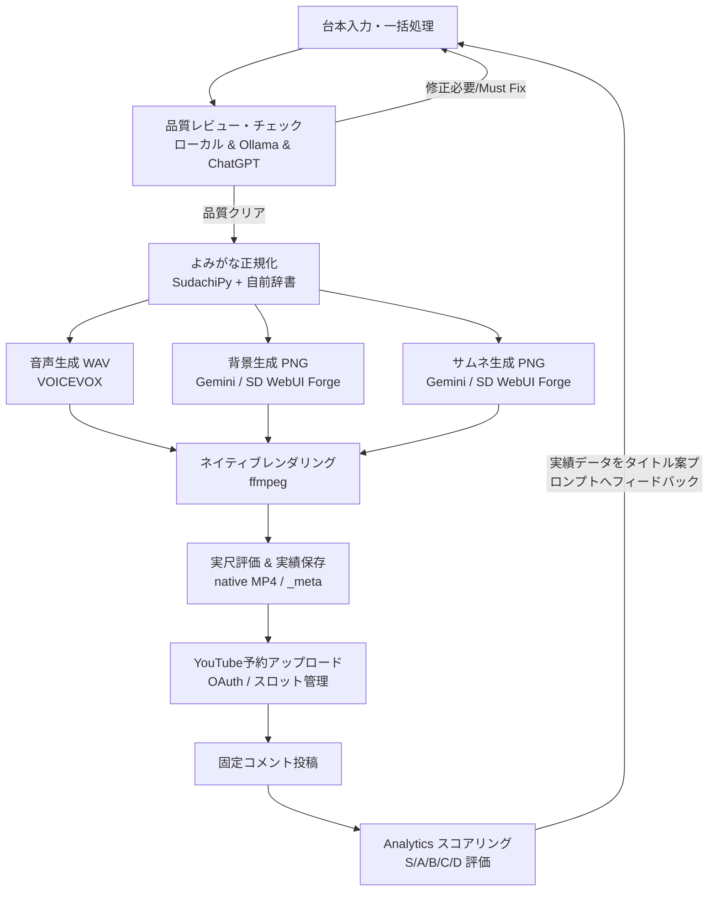

# Native Video Factory 🎥

「ずんだもんとめたんの食べ物雑学堂」向けに、食べ物雑学の解説動画を台本から自動生成するローカルWebツールです。  
台本を入力するだけで、**VOICEVOXによる音声合成**、**Nano Banana / SD WebUI Forge による背景画像・サムネイル生成**、**ffmpegによる高品質なネイティブMP4動画のレンダリング**、そして**YouTubeへの予約投稿・アナリティクス分析**までをシームレスに行うことができます。画像生成バックエンドは `.env` の `IMAGE_BACKEND` で `gemini`（Nano Banana）または `sd_webui`（SD WebUI Forge / AUTOMATIC1111互換API）に切り替えられます。

---

## 🔄 システム処理フロー

本システムは、以下のパイプラインに沿って動画を完全自動で生成・投稿します。



---

## 🚀 クイックスタート

通常運用では、リポジトリ直下の起動スクリプトから起動する方法を推奨します。仮想環境の Python を直接指定して Web UI を起動し、ブラウザも自動で開きます。

1. **VOICEVOX を起動**しておきます（デフォルトポート: `50021`）。
2. リポジトリ直下の起動スクリプトをダブルクリック、またはターミナルから起動します。
   Windows:
   ```powershell
   .\start.bat
   ```
   macOS:
   ```bash
   ./start.command
   ```
3. 自動的にブラウザが立ち上がり、`http://127.0.0.1:58080` にアクセスできます。

`start.bat` は内部で次を実行します。

```cmd
.venv\Scripts\python.exe -m web_app.app --open-browser --reload
```

`start.command` は内部で次を実行します。

```bash
.venv/bin/python -m web_app.app --open-browser --reload
```

普段の操作入口はローカル Web UI です。

---

## 🛠 前提条件 (Prerequisites)

本ツールを使用するには、以下の外部ソフトウェアがローカル環境に導入されている必要があります。

1. **Python 3.10 以上** (本プロジェクトでは `.venv` 仮想環境を使用します)
2. **VOICEVOX** ([公式ホームページ](https://voicevox.nero.ne.jp/)からダウンロード)
3. **ffmpeg** (パスを通しておくか、環境変数 `FFMPEG_BIN` にバイナリパスを指定してください)
4. **Ollama** (冒頭品質レビューに利用。デフォルトモデル: `qwen3:8b`)

---

## 📦 セットアップ手順

### Step 1. 仮想環境と依存パッケージの準備
システムの Python ではなく、プロジェクト専用の `.venv` を使います。既に `.venv` が用意済みなら作成手順は不要です。

`.venv` がない場合:

Windows:
```powershell
py -3 -m venv .venv
```

macOS:
```bash
python3 -m venv .venv
```

*   **PowerShell の場合:**
    ```powershell
    # 仮想環境のアクティベート
    .venv\Scripts\Activate.ps1
    # 依存関係のインストール・更新
    pip install --upgrade -r requirements.txt
    ```
*   **コマンドプロンプト (cmd) の場合:**
    ```cmd
    :: 仮想環境のアクティベート
    .venv\Scripts\activate.bat
    :: 依存関係のインストール・更新
    pip install --upgrade -r requirements.txt
    ```
*   **macOS の場合:**
    ```bash
    .venv/bin/python -m pip install --upgrade -r requirements.txt
    ```

### Step 2. APIキーとOAuth設定ファイルの配置
リポジトリ直下に環境設定ファイル `.env` を作成し、各種APIキーを設定します。Web UI の `設定` 画面からもAPIキーを保存できますが、初回は `.env` を直接作成しておくと確実です。

```env
GOOGLE_API_KEY=your_gemini_api_key
OPENAI_API_KEY=your_openai_api_key
```

*   **`GOOGLE_API_KEY`:** Google AI Studio (Gemini API) から取得します。台本や背景画像の生成に使われます。
*   **`OPENAI_API_KEY`:** OpenAI Platform から取得します。ChatGPT による台本の生成前最終レビュー（`gpt-5.2`）で使われます。
*   **`client_secrets.json`:** YouTube API を利用するための OAuth 2.0 クライアント認証情報（デスクトップアプリ用）です。Google Cloud Console からダウンロードし、**リポジトリ直下**に配置してください。

> [!IMPORTANT]
> - `client_secrets.json`, `.env`, `token.json`, `token_analytics.json` は個人情報やAPIキーを含むため、**絶対に Git にコミットしないでください**（`.gitignore` で除外されています）。
> - YouTubeアップロード、アナリティクス、スケジュール同期などを初めて利用する際、ブラウザが開いて Google 認証を求められます。認証に成功すると、プロジェクトルートに `token.json` と `token_analytics.json` が自動生成されます。

### Step 3. プロンプト設定の確認
初期状態では、本プロジェクトの「食べ物雑学」用の設定が適用されます。  
もし別のジャンルで運用する場合は、`core/prompt_parts/local/` ディレクトリを作成し、そこに個人用プロンプト部品を配置してください（このディレクトリ内のファイルが最優先で読み込まれます）。

*   **食べ物用のデフォルト設定を復元・初期化したい場合 (PowerShell):**
    ```powershell
    New-Item -ItemType Directory -Force -Path core\prompt_parts\local
    Copy-Item -Path samples\prompt_parts\food\* -Destination core\prompt_parts\local\ -Force
    ```

---

### Step 4. Stable Diffusion WebUI Forge で背景・サムネイルを生成する場合

背景画像とサムネイルを **Stable Diffusion WebUI Forge**（または AUTOMATIC1111互換API）で生成できます。Gemini / Nano Banana の代替として、APIキーなしでローカルに画像生成したい場合に使用します。

#### 前提

- Forge / AUTOMATIC1111 を `--api` オプション付きで起動していること。
  ```
  webui.bat --api
  ```
- APIが `http://127.0.0.1:7860` で応答していること（URLは `.env` で変更可）。
- `IMAGE_BACKEND=sd_webui` にした場合、**Gemini 画像生成APIは使用しません**。

#### .env 設定例

```env
IMAGE_BACKEND=sd_webui
SD_WEBUI_BASE_URL=http://127.0.0.1:7860
SD_WEBUI_TIMEOUT_SEC=180
SD_WEBUI_MODEL=
SD_WEBUI_SAMPLER=DPM++ 2M Karras
SD_WEBUI_STEPS=24
SD_WEBUI_CFG_SCALE=7
SD_WEBUI_WIDTH=1024
SD_WEBUI_HEIGHT=576
SD_WEBUI_NEGATIVE_PROMPT=people, human, person, face, hands, photorealistic, realistic photo, bad anatomy, blurry, low quality, watermark, signature, logo, unreadable text, garbled text

# モデル管理（任意）
SD_WEBUI_ROOT=C:\path\to\stable-diffusion-webui
SD_MODEL_MANIFEST_PATH=assets/sd_webui/model_manifest.json
AUTO_DOWNLOAD_SD_MODELS=0
# Hugging Face 認証が必要なモデルのダウンロードに使用（requires_auth=true のモデル）
HF_TOKEN=
```

> [!IMPORTANT]
> - `IMAGE_BACKEND=sd_webui` のとき、Forge が未起動であれば画像生成は**フォールバックせず停止**します。
> - Gemini / Nano Banana への自動切替は一切行いません。
> - `SD_WEBUI_MODEL` が空の場合は Forge に現在ロード中のモデルをそのまま使います。
> - `SD_WEBUI_MODEL` を設定した場合、画像生成前にマニフェストでインストール確認 → 未インストールなら `AUTO_DOWNLOAD_SD_MODELS=1` 時は自動DL、`0` 時はエラー停止 → `set_active_model()` を実行します。
> - Shorts（縦動画）では幅・高さが自動で入れ替わります（`SD_WEBUI_WIDTH` / `SD_WEBUI_HEIGHT` は横動画基準で設定してください）。
> - 画像生成前に SD WebUI を手動で起動しておいてください（`--api` オプション必須）。

#### SD WebUI モデル管理 Web UI

Web UI の「Stable Diffusionモデル」ページ（`/sd-models`）から、モデルのダウンロード・インストール・切り替えをアプリ内で完結できます。

- **「次の生成で使われるモデル」バナー**: `SD_WEBUI_MODEL` 設定値または Forge 現在ロード中モデルを最上部に表示
- **ダウンロード**: `source_url` が設定されたモデルはワンクリックでダウンロード・SHA256検証・配置・Forge 再スキャンまで自動実行
- **「このモデルを使う」**: Forge への即時切り替え + `SD_WEBUI_MODEL` を `.env` へ保存（次回起動後も維持）
- **「削除して再DL」**: 破損・SHA256不一致時に既存ファイルを削除して再ダウンロード（確認ダイアログあり）

> `source_url` が空のモデル（Anything V5 など CivitAI 配布のもの）は手動ダウンロードが必要です。モデル情報欄の配布ページ URL からダウンロードして `{SD_WEBUI_ROOT}\models\Stable-diffusion\` に配置し、「WebUI 再スキャン」ボタンを押してください。

#### Hugging Face 認証が必要なモデル（`requires_auth=true`）

SD 1.5 などライセンス同意が必要なモデルは `HF_TOKEN` の設定が必要です。

1. [Hugging Face](https://huggingface.co/settings/tokens) でアクセストークンを取得
2. モデルのページでライセンスに同意しておく
3. Web UI の `設定 > APIキー設定` で `HF_TOKEN` に貼り付けて保存

```env
# .env に直接書く場合
HF_TOKEN=hf_xxxxxxxxxxxxxxxxxxxxxxxx
```

#### バックエンド切り替え一覧

| `IMAGE_BACKEND` | 画像生成手段 | Gemini APIが必要か |
|:--- |:--- |:---:|
| `gemini`（デフォルト） | Nano Banana / Gemini 画像生成 | ✅ 必要 |
| `sd_webui` | Stable Diffusion WebUI Forge / A1111 | ❌ 不要 |

---

## 💻 起動方法と起動オプション

### 推奨: 起動スクリプトで起動

通常はOS別の起動スクリプトを使います。仮想環境の有効化操作は不要です。

Windows:
```powershell
.\start.bat
```

macOS:
```bash
./start.command
```

VOICEVOXを起動してから実行してください。起動後は `http://127.0.0.1:58080` を開きます。

### 手動起動（トラブル対応・開発用）

ポート変更やリロード設定を自分で指定したい場合だけ、仮想環境の Python を直接実行します。

*   **通常起動 (PowerShell):**
    ```powershell
    .\.venv\Scripts\python.exe -m web_app.app
    ```
*   **通常起動 (macOS):**
    ```bash
    .venv/bin/python -m web_app.app
    ```
*   **自動でブラウザを開く場合:**
    ```powershell
    .\.venv\Scripts\python.exe -m web_app.app --open-browser
    ```
    ```bash
    .venv/bin/python -m web_app.app --open-browser
    ```
*   **開発用（ファイル変更時の自動リロードを有効にする）:**
    ```powershell
    .\.venv\Scripts\python.exe -m web_app.app --reload --open-browser
    ```
    ```bash
    .venv/bin/python -m web_app.app --reload --open-browser
    ```

> [!TIP]
> **Windowsで「Python was not found...」というエラーが出る場合:**
> システム環境変数 (PATH) に Python が通っていない可能性があります。まず `start.bat` を使ってください。手動起動する場合は、上記の通り `.\.venv\Scripts\python.exe` のように**仮想環境のパスを明示的に指定して実行**します。

### 主要な起動引数

| オプション | 説明 |
| :--- | :--- |
| `--port N` | ポートを指定して起動（デフォルト: `58080`） |
| `--auto-port` | 指定ポートが競合している場合、自動的に次の空きポートを探して起動 |
| `--open-browser` | サーバー起動後、自動的に既定のウェブブラウザを開く |
| `--reload` | 関連ソースコードの変更を検知した際に、自動でUvicornサーバーを再起動する（起動スクリプトでは既定で有効） |

---

## 📝 基本のワークフロー

1.  **起動:** VOICEVOXを起動し、OS別の起動スクリプトでWeb UIを開きます。
2.  **実績の同期:** `Analytics` 画面で YouTube Analytics の最新実績データを取得します。
3.  **タイトル案プロンプト作成:** `生成` 画面の `Shortsタイトル案プロンプト` / `Longタイトル案プロンプト` をコピーし、実績データを組み込んだプロンプトで AI にタイトル案を出させます。
4.  **台本作成:** 採用したタイトルから、`AI台本作成プロンプト` をコピーして AI に台本を作成させます。
5.  **台本のチェック・生成:** Web UI の台本欄に貼り付け、必要に応じて `チェック` 画面または生成前レビューで確認し、`生成開始` を押します。
6.  **画像・動画の確認:** `履歴` または `画像確認・再生成` 画面でサムネイルと背景画像を確認します。気に入らない画像は左のチェック欄で選択し、画像一覧上部の `選択画像を再生成` から再生成します。
7.  **最終確認とアップロード:** 履歴詳細でMP4を確認し、`アップロード` 画面から YouTube 予約スロットへ投稿します。
8.  **固定コメントの投稿:** `固定コメント` 画面で公開済み動画だけを対象にコメント投稿します。YouTube上で手動投稿した場合は `投稿済みにする` でローカル記録を更新します。
9.  **スケジュール確認:** `スケジュール` 画面で YouTube 側の予約状態を同期し、必要に応じて公開予定変更や詰め直しを行います。

---

## 📜 台本フォーマット

台本テキストの先頭に動画のメタ情報を定義し、空行を挟んでセリフや演出を記述します。

```text
動画形式: Shorts
動画タイトル: チョコは500年間ずっと飲み物だった
サムネ文字: 飲み物
説明文: チョコレートの驚きの歴史を解説！
タグ: ずんだもん,ゆっくり解説,VOICEVOX,食べ物 雑学,雑学 ショート
生成区分: 横展開

背景: 漫画風イラスト調。ヨーロッパの古い街並み。
ずんだもん(ノーマル): チョコは昔、薬の飲み物だったのだ！
四国めたん(ツンツン): えーっ！薬ですの！？
テロップ: 薬だった！
```

*   **`()`**: VOICEVOX のスタイル指定（例: `あまあま`, `ツンツン`）。
*   **`[]`**: ネイティブ立ち絵の表情指定（例: `[驚き]`, `[ジト目]`）。
*   **複数動画の一括処理:** `━━ 動画1 ━━` や `━━ 動画2 ━━` などの区切り行を挟むことで、複数の台本を一度に分割処理できます。

---

## ⚙️ 主な設定値 (config.py)

APIキーやOAuthファイルなどの認証情報以外は、原則として `config.py` の既定値を使います。必要な場合だけ `.env`、環境変数、またはWeb UIの `設定` 画面で上書きできます。

設定値の優先順位は **`.env` / 環境変数 > `config.py` の既定値** です。`config.py` はリポジトリ共通のデフォルト、`.env` は各PCのローカル上書き設定として扱います。Web UIの `設定` 画面で保存した値も `.env` に書き込まれます。多くの設定は保存後すぐ現在のWebプロセスへ反映されますが、ポート番号や起動時にだけ読む設定はアプリ再起動後に反映されます。`.env` は個人設定・APIキーを含む可能性があるためコミットしません。

| 設定項目 | 既定値 | 説明 |
| :--- | :--- | :--- |
| `GEMINI_MODEL` | `gemini-3.1-pro-preview` | 台本の生成プロンプトや修正用のAIモデル名 |
| `NANOBANANA_PRO_MODEL` | `gemini-3-pro-image-preview` | 背景・サムネ生成の高品質画像生成モデル |
| `NANOBANANA_FLASH_MODEL` | `gemini-3.1-flash-image-preview` | 画像生成の高速画像生成モデル |
| `NATIVE_AUDIO_LOUDNORM_ENABLED` | `True` | 最終的なMP4音声にラウドネス正規化 (loudnorm) を適用するか |
| `NATIVE_BGM_VOLUME_DB` | `-20` | レンダリング時の BGM 音量 (dB) |
| `CHARACTER_UPPER_BODY_MODE` | `True` | 立ち絵を腰から上で拡大して表示するモード（True=有効） |
| `MAX_BACKGROUNDS_SHORTS` | `9` | Shorts 1本あたりに生成する背景画像の最大枚数 |
| `MAX_BACKGROUNDS_LONG` | `90` | ロング動画における通常時の背景画像最大枚数 |
| `MAX_BACKGROUNDS_LONG_BUDGET` | `16` | ロング動画の「画像節約モード」有効時の背景画像最大枚数 |
| `LONG_UPLOAD_PLAYLIST_NAME` | `ロング動画` | Long動画アップロード成功後に、自動的に追加する再生リスト名 |
| `TOPIC_REQUEST_CTA_EVERY_N` | `5` | Shorts新規/横展開の「ネタ募集CTA」を通算何本に1本許可するか。`0` なら自動付与しない |

---

## ⚠️ 注意・制約事項

*   **ローカル限定:** Web UI は `127.0.0.1` で使う前提です。認証なしで外部公開しないでください。
*   **秘密情報:** `.env`、`client_secrets.json`、`token.json`、`token_analytics.json` などの認証情報はコミットしないでください。
*   **外部API費用:** ChatGPT API と Google API（Gemini / Nano Banana 画像生成など）は費用が発生します。画像再生成やレビュー実行時は選択内容を確認してください。

---

## 📢 CTA/Long動画の運用ポリシー

*   **Shorts本編のループ視聴優先:** 
    動画の離脱を防ぐため、Shorts本編での「チャンネル登録お願いします」や「次の動画も見てね」といった直接的な誘導セリフは生成前チェックで警告が出ます。「ネタ募集CTA」はShortsの新規/横展開を通算で数え、既定では5本に1本だけ自動許可します。`TOPIC_REQUEST_CTA_EVERY_N=0` の場合は自動付与しません。対象かどうかはAnalytics画面の「ネタ募集CTA」列と `_meta/cta_policy.json` で確認できます。
*   **Long動画の目次（チャプター）自動追加:**
    Long動画アップロードの際は、台本の内容からAIがYouTube概要欄用の `【目次】(0:00形式)` チャプターマーカーを自動で生成し、説明文の末尾に追加します。
*   **Longサムネイル A/B テスト:**
    Web UI の「LongサムネAB」チェックボックスをONにすると、自動的に3パターンのサムネイル画像 (Variant A, B, C) が出力されます。YouTube Studio でのテスト用にご活用ください。

