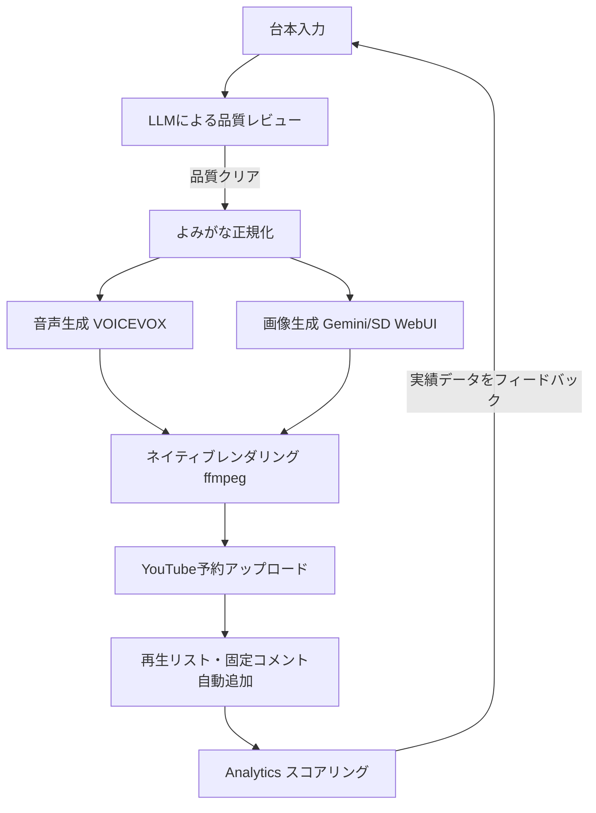

<div align="center">
  <h1>🎥 Native Video Factory</h1>
  <p><strong>複数YouTubeチャンネル対応の台本生成→動画→アップロード→Analytics確認までを行うローカルWebツール</strong></p>

  
  
  
  
</div>

<br />

> 台本を入力するだけで、**VOICEVOXによる音声合成**、**AIによる背景画像・サムネイル生成**、**ffmpegによる高品質なMP4動画のレンダリング**、そして**YouTubeへの予約投稿・アナリティクス分析**までをシームレスに行うことができるローカルWebツールです。

---

## 📑 目次

- [🚀 クイックスタート](#-クイックスタート)
- [🔄 システム処理フロー](#-システム処理フロー)
- [🛠 前提条件](#-前提条件-prerequisites)
- [📦 セットアップ手順](#-セットアップ手順)
- [💻 起動方法と起動オプション](#-起動方法と起動オプション)
- [📝 基本のワークフロー](#-基本のワークフロー)
- [🖥️ Web UI 画面一覧](#️-web-ui-画面一覧)
- [📁 フォルダ構成](#-フォルダ構成)
- [🛟 トラブルシューティング](#-トラブルシューティング)
- [⚠️ 注意・制約事項](#️-注意制約事項)
- [🖥 開発環境](#-開発環境)

> [!NOTE]
> 台本の記述フォーマット、各種設定値の詳細、システムの詳細な仕様については **[SPEC.md](SPEC.md)** を参照してください。
> 日々の具体的な操作手順については **[MANUAL.md](MANUAL.md)** を参照してください。

---

## 🚀 クイックスタート

1. **VOICEVOX を起動**しておきます（デフォルトポート: `50021`）。
2. リポジトリ直下の起動スクリプトをダブルクリック、またはターミナルから起動します。

   **Windows:**
   ```powershell
   .\start.ps1
   ```
   **macOS:**
   ```bash
   ./start.command
   ```
3. 自動的にブラウザが立ち上がり、システムにアクセスできます。

> [!TIP]
> 開発時（ソース変更を即時反映したい場合）は `start-dev.ps1` / `start-dev.command` を使ってください。

---

## 🔄 システム処理フロー



---

## 🛠 前提条件 (Prerequisites)

| ソフトウェア | 用途 | 備考 |
|:---|:---|:---|
| **Python 3.10+** | 実行環境 | `.venv` 仮想環境を使用 |
| **VOICEVOX** | 音声合成 | デフォルトポート `50021` |
| **ffmpeg** | 動画レンダリング | `h264_nvenc`（GPU）または `libx264`（CPU）|
| **Ollama** | 品質レビュー等 | デフォルトモデル: `qwen3:8b` |
| **Google AI Studio** | 台本・画像生成 | `GOOGLE_API_KEY` 必須 |

---

## 📦 セットアップ手順

### Step 1. 仮想環境と依存パッケージの準備

**Windows:**
```powershell
py -3 -m venv .venv
.venv\Scripts\Activate.ps1
pip install --upgrade -r config/requirements.txt
```

**macOS:**
```bash
python3 -m venv .venv
source .venv/bin/activate
pip install --upgrade -r config/requirements.txt
```

### Step 2. 認証情報の登録

認証情報はすべて **設定画面の「APIキー」タブ** から登録します。
情報は active channel profile ごとにデータベースへ暗号化保存されるため、チャンネルを切り替えて個別に管理できます。
チャンネルの `profile_id` / `genre_profile` / `output_root` はチャンネルハンドル（`@` なし）で統一されます。
チャンネル詳細画面から、そのチャンネル専用の APIキー・YouTube Client Secrets を登録できます。
投稿予約スロットもチャンネル別に管理されます。既定値は全チャンネル共通で、Shorts が 07:00 / 12:00 / 21:00、Long が 22:00、タイムゾーンは Asia/Tokyo です。

| 項目 | 用途 |
|:---|:---|
| **Google API Key** | Gemini API（台本・背景・サムネイル生成） |
| **OpenAI API Key** | ChatGPT（台本の最終レビュー） |
| **HF Token** | Hugging Face（SD WebUI モデルDL用・任意） |
| **YouTube Client Secrets** | OAuth クライアント情報（JSON文字列） |

> [!IMPORTANT]
> OAuthやAPIキーを含んだファイル（`.env` 等）は **絶対に Git にコミットしないでください**。

### Step 3. YouTube OAuth 認証

1. Google Cloud Console で OAuth 2.0 クライアントを作成し、JSONをコピーする。
2. 設定画面の「YouTube Client Secrets 登録」に貼り付けて保存する。
3. アップロード用およびアナリティクス用の認証ボタンを押し、ブラウザでGoogleアカウント認証を完了する。

---

## 💻 起動方法と起動オプション

### 通常起動（推奨）

```powershell
.\start.ps1         # Windows
./start.command     # macOS
```

### 手動起動・オプション

```powershell
.\.venv\Scripts\python.exe -m web_app.app --open-browser
```

| オプション | 説明 |
|:---|:---|
| `--port N` | ポートを指定（デフォルト: `58080`） |
| `--auto-port` | 競合時、自動的に次の空きポートを探す |
| `--open-browser` | 起動後に自動でブラウザを開く |
| `--reload` | ソース変更で自動再起動（開発向け） |

### 終了方法

- **Web UI から終了:** 画面右上の「⏻ 終了」ボタンをクリック。
- **ターミナルから終了:** `Ctrl+C` を押すと安全に終了処理（shutdown hook）が実行されます。

---

## 📝 基本のワークフロー

※詳細は **[MANUAL.md](MANUAL.md)** をご覧ください。

1. **実績同期:** アナリティクス画面で YouTube の視聴データを取得。
2. **台本作成:** 実績を基にプロンプトを生成し、AIに台本を作成させる。
3. **動画生成:** 動画生成画面に台本を貼り付け、「生成開始」を実行。
4. **素材確認:** 画像確認画面や履歴詳細から、背景・サムネイルを確認。必要なら手動差し替えも可能。
5. **レンダリング:** 履歴詳細の「動画再作成（レンダーのみ）」で、選択したBGMを使ってMP4化。
6. **アップロード:** アップロード画面から一括でYouTubeへ予約投稿。
7. **コメント投稿:** 固定コメント画面で、公開済み動画へコメントを投稿。

---

## 🖥️ Web UI 画面一覧

| 画面名 | 主な用途 |
|:---|:---|
| **ホーム** | 外部サービスの稼働状況確認 |
| **動画生成** | 台本から音声・画像・動画を一括生成 |
| **台本チェック** | 生成前の品質チェック・プリフライト |
| **履歴一覧** | 生成済み動画の管理・再生成・アップロード |
| **画像確認** | 背景・サムネイルの確認、個別再生成、手動差し替え |
| **アップロード** | YouTubeへの一括予約投稿 |
| **固定コメント** | 公開済み動画への自動コメント投稿 |
| **スケジュール** | 予約状態の確認・再配置 |
| **アナリティクス** | 視聴データ取得・評価スコアリング |
| **設定** | パラメータの変更・認証情報登録・チャンネル別BGM/投稿予約スロット管理 |

---

## 📁 フォルダ構成

```text
.
├── config/        # 定義・プロンプト・要件定義
├── core/          # ビジネスロジック・画像音声生成エンジン
├── workers/       # バックグラウンド処理パイプライン
├── web_app/       # FastAPIベースのWeb UI
├── data/          # 設定DB・よみがな辞書
├── assets/        # BGM・効果音・キャラ立ち絵
├── output/        # 動画生成物・メタデータDB（自動生成・Git管理外）
└── start.ps1      # 起動用スクリプト
```
※ 詳しいモジュール構成は `SPEC.md` を参照してください。

---

## 🛟 トラブルシューティング

- **音声が生成されない:** VOICEVOX が起動しているか（デフォルト `http://localhost:50021`）確認してください。
- **画像が生成されない:** 設定画面で Google API Key が「登録済み」になっているか確認してください。
- **GPU エンコードが使われない:** `h264_nvenc` が利用不可の場合は自動的に CPUエンコード (`libx264`) に切り替わります（ログに警告が出ます）。
- **アプリが終了しない:** 生成処理中（worker稼働中）に終了ボタンを押すと確認ダイアログが出ます。「停止して終了」を選んでください。

---

## ⚠️ 注意・制約事項

- **ローカル限定:** Web UI はローカルホスト（`127.0.0.1`）のみで起動します。外部公開は危険ですので行わないでください。
- **外部API費用:** ChatGPT や Gemini API には利用料金が発生する場合があります。
- **アップロードの非可逆性:** 公開後のYouTube動画IDは変更できません。まずはテスト用チャンネル等で動作確認することを推奨します。

---

## 🖥 開発環境

- OS: Windows 11
- Python: 3.11.9
- ffmpeg: 8.0.1 (NVENC 対応)
- FastAPI: 0.136.3
